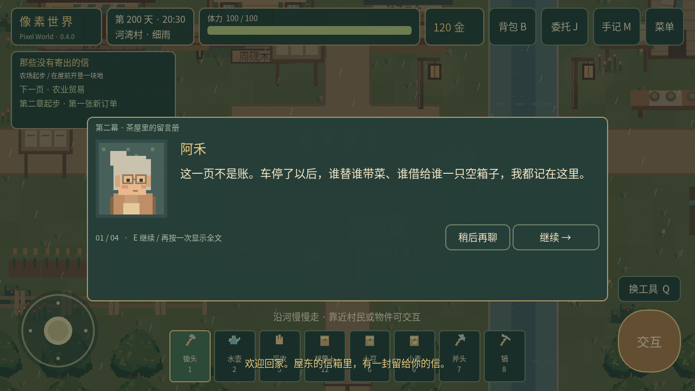
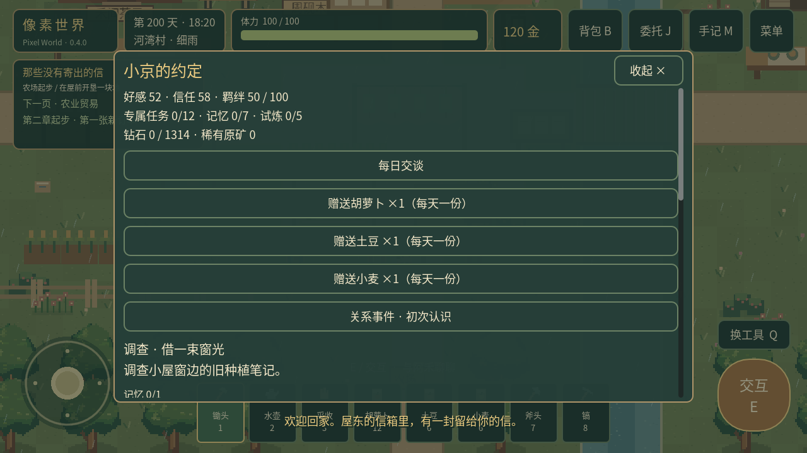

# 像素世界 · Pixel World

Godot **4.3 Standard** / GDScript 原创像素经营 RPG，当前版本 **0.4.0**。本次在原工程上重构主线《那些没有寄出的信》第一章《河水带走的名字》，新增隐藏支线《小京的约定》的可玩基础。保留原有三张地图、作物、背包、商店、采集、修缮、共建、委托、声音和存档。

**Android 默认点击移动、自动寻路和到达后智能交互；菜单可随时切换备用虚拟摇杆，选择自动保存。** 小京的150–250小时终局目标尚未完成：现有勘探和五种试炼是基础原型，不能视为完整多层矿洞与长期体验验收。详见[当前进度与未完成清单](docs/PROJECT-STATUS-0.4.0.md)。



## 运行

使用 Godot 4.3 Standard 导入 [project.godot](project.godot)，等待素材导入后按 F5。不需要插件或 .NET，游戏运行不依赖 Python。Windows 可直接导入；Windows EXE 和 Windows 实机尚未验收。

当前 Linux 工作区：

```bash
./.tools/Godot_v4.3-stable_linux.x86_64 --path .
```

`.tools/` 只供本机构建验证，不打进源码包。完整工程交付为 `builds/PixelWorld-0.4.0-source.zip`，Android 调试包为 `builds/PixelWorld-0.4.0-debug.apk`，本次没有发布到 GitHub Releases。

## 操作

| 操作 | 电脑 | 当前 Android |
|---|---|---|
| 移动 | WASD / 方向键 / 鼠标左键 | 点击地面自动寻路；备用摇杆 |
| 工具 / 靠近交互 | 点击目标 / E / 空格 | 点击人物、田地或物件，靠近后自动执行一次 |
| 工具选择 | 1–8 / Q | 工具栏 / 换工具 |
| 背包 / 委托 / 剧情手记 | B / J / M | 右上对应按钮 |
| 菜单 | Esc | 右上菜单 / 系统返回 |
| 保存 / 读取 | F5 / F9（运行窗口中） | 菜单 |

工具依次为锄头、水壶、采收、胡萝卜种子、土豆种子、小麦种子、斧头、镐。默认点击田地自动翻土、为已播种作物浇水、收获成熟作物；空田按选中的种子播种。工具栏的主动选择优先用于下一次点击，之后恢复智能判断，菜单可关闭辅助。树石每次点击只采集一下。菜单中的操作方式可自由切换，切换立即清空旧移动与交互，重启恢复选择。详见[点击操作说明](docs/TOUCH-CONTROLS.md)。

初始120金、100体力、胡萝卜种子12、土豆种子6、小麦种子6。屋前浅色土地可耕种：翻土→选种子播种→浇水→回小屋休息，按需连续照料后收获；收获不自动出售。胡萝卜/土豆/小麦分别需要2/3/2个浇过水的生长日；种子12/18/8金，收购36/56/22金。失败操作不扣资源。背包每类普通物品上限999。

一天06:00–24:00，现实每秒走2游戏分钟，可睡到次日。对话、背包、商店、菜单及后台暂停时间。第4、7、11、14……天细雨，先结算昨夜成长再补新一天雨水。缺水暂停成长，不会枯死。翻土耗2体力，其他成功农活耗1；砍树/采石每次耗3。

## 第一章：河水带走的名字

1. 进小屋，读窗下木盒里的旧信和残缺地图；农场信箱也能读信与回顾。
2. 找林芽，完成种植、浇水和收获教学，交付三个胡萝卜，获得50金。
3. 北面路牌进河湾村，调查**桥西水位牌**和**木作坊檐下维修记录**，再与周砚交谈。
4. 与阿禾读茶屋留言册，了解居民为何离开；备木材8、石料6，在桥头一起修桥。
5. 步行过桥探索东岸，读风车货运簿。风车旁旧货箱可读两条不同便条。
6. 在共建板修好水井、共仓和茶座，回去找阿禾。这里通过生活变化推进，无须再交一批食材。
7. 18:00后到风灯架，选择农业贸易、自然探索或居民生活；长椅可等到傍晚。

三个方向分别奖励胡萝卜种子3、小麦种子6、土豆种子3，另有原有120金庆典奖励。选择改变第二章起步任务的推荐顺序与对白，**三个方向的起步任务全部开放**；第二章长篇主线尚未完成。

林芽白天经营农场种子摊，傍晚去广场/茶座；周砚工作时去木作坊或桥边；阿禾午间会使用已修好的水井，傍晚去茶座。人物手记有活动位置提示。NPC采用少量固定站点和四向网格移动，对话时停下；风灯装饰持续保留。

| 公共设施 | 费用 | 效果 |
|---|---|---|
| 清泉水井 | 木4、石6、40金 | 每日一次浇透已开垦农田 |
| 种子共仓 | 木8、石2、60金 | 种子八折，每袋向上取整 |
| 树荫茶座 | 木6、石4、40金 | 每日热茶恢复40体力，满体力不浪费次数 |

原有农场工具架、引水渠、卧室升级和三份河谷委托继续保留。树木3次掉木4、3日再生；石堆2次掉石3、2日再生；工具架提高伤害，再生会避开玩家。卧室使体力上限130，引水渠自动照料西北4×3格。

## 隐藏支线：小京的约定



从本版本开始累计**成功播种520次**，在20:00后的夜晚收到神秘来信。旧档没有历史计数，不推算以往播种。读完信后，小京白天在河东观察站，18:00–20:00在已建茶座，否则傍晚在农场东南星灯台；婚后21:00以后回小屋。

点击小京自动靠近，或靠近后按交互，可交谈、赠礼、查看关系、完成任务和进行勘探。好感/信任/羁绊三项独立；每日交谈、赠礼、共同活动均有每日限额。包含12项专属任务、三地图七份记忆、五段关系事件、经营/规划/基础矿道/星灯机关/联合考察五种试炼。完整说明含剧透，见[小京剧情与数值](docs/XIAOJING.md)。

婚礼必须三属性100、全部专属任务/记忆/试炼/关系事件、正式恋爱并修复温室。**确认婚礼才消耗1314颗钻石点亮星灯；取消不扣钻石。** 温室结构修复另需木80、石60、800金。钻石独立储存，不占普通999堆叠，不在普通商店销售。勘探失败可沿安全绳退出，重复勘探会重置矿晶，不会因一次性宝箱耗尽而锁死。

婚后保留小京独立工作安排、日常与两个专属事件，第520个婚后游戏日开放一封回信。基础矿道是界面中的9×9路线规划盘，含气囊、矿脉和回程规则；**没有完成可自由行走的多层矿洞地图**。

## 存档与更新

仍使用 `user://farm_save.json`，并保留 `.bak`；先完整校验再恢复，写临时文件后替换，主档损坏时尝试备份。不删除玩家存档。更名固定原有桌面用户目录；Windows 仍是 `%APPDATA%\Godot\app_userdata\Pixel Farm · 风芽农场\`，Linux 仍是 `$XDG_DATA_HOME/godot/app_userdata/Pixel Farm · 风芽农场/`（缺省 `~/.local/share`）。

当前存档 **v6**：v1→v2→v3→v4剧情迁移→v5小京状态→v6操作模式。v1–v5旧档默认点击移动；运行时路径和待执行动作不存入存档。金币、物品、农田、作物、日期、位置、修缮、共建、好感和旧奖励保留。旧版首章通关不用重玩，可在信箱回顾、风灯架选择新方向。已建工程不再扣材料。[迁移说明](docs/SAVE-MIGRATION.md)

Android 包名仍为 `org.pixelfarm.windbud`，versionCode提高到5，复用0.3.0签名；不要卸载旧版或清除应用数据。覆盖更新仍需真机验证。

## 验证与交付文档

```bash
python3 tools/check_project.py
python3 tools/simulate_xiaojing.py
python3 tools/build_android.py
python3 tools/verify_apk_runtime.py
python3 tools/package_source.py
```

测试入口使用隔离用户目录，包含编辑器导入、原有玩法回归、新剧情、小京全流程、跨进程存档和主场景启动。Android构建复用本地工具及原密钥，签名不匹配会拒绝交付；不自动下载或安装到设备。

- [剧情设计与任务流程图](docs/STORY-0.4.0.md)
- [小京支线、平衡表与分阶段计划](docs/XIAOJING.md)
- [存档迁移](docs/SAVE-MIGRATION.md)
- [测试报告](docs/VALIDATION.md)
- [Android说明](docs/ANDROID.md)
- [更新日志](docs/CHANGELOG.md)
- [本阶段完成范围与剩余内容](docs/PROJECT-STATUS-0.4.0.md)

尚无Android真机、Windows实机、手机帧率/功耗、150–250小时试玩验收结果。素材为本项目原创像素几何绘制，沿用已有图标，小京另有独立角色和头像；无外部游戏美术或剧本文本。[素材与许可](docs/ASSET_PROVENANCE.md)
