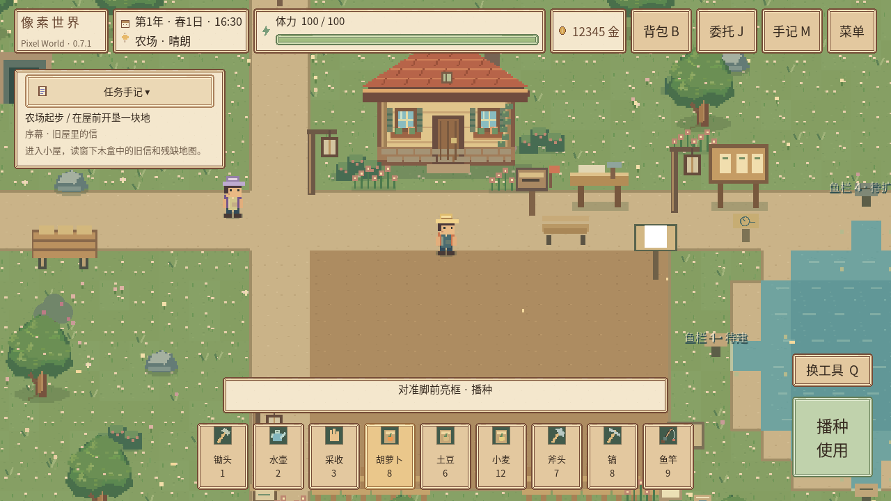
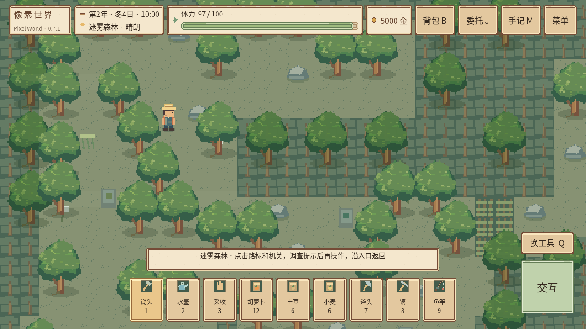
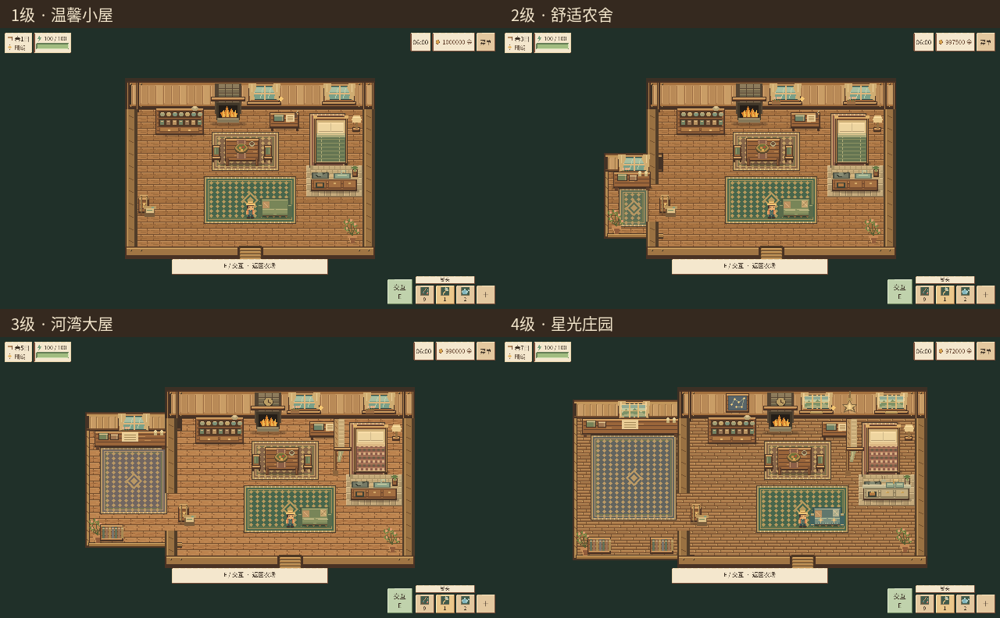
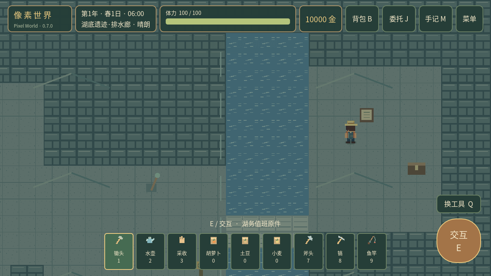

# 像素世界 · Pixel World

当前源码和调试APK已包含[移动精修](docs/TOUCH-POLISH-01.md)、[农活精修](docs/FARMING-POLISH-02.md)、[饮食恢复调整](docs/FOOD-RECOVERY.md)、[背包快捷栏](docs/INVENTORY-POLISH-03.md)、[UI04视觉统一](docs/REPORT-UI04.md)、[UI05沉浸式视野](docs/REPORT-UI05.md)、[住宅05四阶段住宅与小睡](docs/REPORT-HOME05.md)及[原布局恢复与资源丰富森林](docs/RESTORED-LAYOUT-RESOURCES.md)。

**0.7.1《匠心打磨》**，Godot 4.3 Standard 原创像素经营 RPG。在原工程上整合四季天气、自由钓鱼、湖泊生态、畜牧、厨房加工、四季节日、村民个人事件、家园扩建装修与三张隐藏地图。

保留原种田/采集/经济、三张原地图、第一章与第二章、百层深渊、小京520播种/三属性/12任务/7记忆/5试炼/1314钻石婚礼及婚后520日。当前存档 **v23**，兼容v1–v22，原应用包名、证书与存档路径保留。

最新源码完整验证见[布局与资源机器记录](docs/TEST-CLASSIC-RESOURCES.json)：**4,064项自动化、2,448项桌面窗口检查零失败**，包括五横屏/安全区及64/96逻辑触区的密度注入布局检查。Android调试APK已重新生成；没有Android真机验收。

[当前布局与森林报告](docs/RESTORED-LAYOUT-RESOURCES.md) · [住宅05报告与四级截图](docs/REPORT-HOME05.md) · [UI05报告与前后截图](docs/REPORT-UI05.md) · [布局规范](docs/UI05-LAYOUT.md) · [UI04报告](docs/REPORT-UI04.md) · [初版开发报告](docs/REPORT-0.7.1.md) · [0.7.0内容报告](docs/REPORT-0.7.0.md) · [操作与玩法](docs/GUIDE-0.7.0.md) · [测试记录](docs/VALIDATION.md) · [UI05验收边界](docs/KNOWN-ISSUES-UI05.md)



当前恢复完整顶栏与底部九格工具栏。农场42、村庄外围16、迷雾森林70个可再生树石点；森林从农场西北的“西北林径”进入。四级住宅和小睡功能保留。



以下为住宅05历史界面截图，住宅外观与功能仍保留：



住宅可通过周砚进行两日改建；沙发小睡一小时恢复最大体力50%，午夜仍优先正常昏睡。[小睡演示](docs/home05/sofa-demo.gif) · [室内前后对照](docs/home05/compare-interior.png)。

UI05紧凑版已恢复为上方的完整布局；[旧界面仅作历史对照](docs/ui05/compare-hud.png)。

空闲时拖动画面自由观察，松手保留视野；点击“回中”或开始移动恢复跟随。底部九格工具栏常驻，任务默认展开且可折叠。[查看前后对照](docs/ui05/compare-hud.png)。

## 运行与下载

Godot **4.3 Standard** 导入`project.godot`，完成素材导入后按F5；不需要.NET或插件。Python只用于开发工具，游戏运行不依赖Python。Windows/macOS可导入源码，但本轮没有这些平台的实体机测试。

```bash
./.tools/Godot_v4.3-stable_linux.x86_64 --path .
```

- [Android调试APK](builds/PixelWorld-0.7.1-debug.apk) · [APK校验和](builds/PixelWorld-0.7.1-debug.apk.sha256)
- [完整源码包](builds/PixelWorld-0.7.1-source.zip) · [源码校验和](builds/PixelWorld-0.7.1-source.sha256)

源码包不含本机引擎、SDK、签名密钥或玩家存档。Android构建必须使用原签名，见[ANDROID.md](docs/ANDROID.md)。本次没有在手机安装或执行覆盖更新。

## 操作

| 行为 | 桌面 | Android |
|---|---|---|
| 移动 | WASD/方向键/鼠标点击 | 默认点击自动寻路，设置可切换备用摇杆 |
| 交互 | 点击对象/E/空格 | 点对象，沿合法位置靠近后执行一次 |
| 工具 | 1–9 / Q | 下方工具栏；第9格鱼竿 |
| 背包/委托/手记 | B/J/M | 右上对应按钮 |
| 保存/读取/菜单 | F5/F9/Esc | 菜单与系统返回 |
| 钓鱼 | 按住追鱼按钮或空格，松开调整 | 长按/松开追鱼按钮 |
| 装修 | 选择家具、网格落点、确认 | 同样使用原生触屏按钮与滚动 |

浇水时脚底与朝向短暂固定，人物图像不再水平累加偏移；地图点击使用按下时的世界位置，避免跟随相机后释放到另一格。按下时同时保留NPC/动物身份，释放后不会因它们走动误点地面。目标环区分地面、交互与不可达；UI、多指、混合鼠标触屏、切图、模式切换与后台均有取消/防误触处理。手记“村里的邻居”与地图显示实际活动位置。

## 每天的安排

现实1秒＝游戏2分钟，一天06:00–24:00，正常约9分钟。20:00前不能主动睡觉，20:00后确认休息；午夜疲劳昏睡恢复六成，每天只结算一次。菜单、对话及后台暂停正常时间。

菜单“操作与生活指南”随时查看八类说明；新玩家轻提示只展示一次，旧存档默认已读。商店“出售全部”现在先确认数量和总价，取消保留物品。

体力不足时可用：屋东休息椅每日3次，每次花20游戏分钟恢复15；现有食物只要持有且体力未满即可继续吃，每次消耗1份，胡萝卜/土豆/小麦恢复8/12/4；鱼干/鱼汤恢复18/30，厨房料理按原值恢复，均无每日食用次数限制。已有料理增益不叠加、不覆盖或延长。建成茶座后每日热茶40。满体力不消耗恢复物品或次数，椅子不触发作物/矿石/鱼群跨天。

每季28日、每年112日。雨自动浇露天田，雪不算雨；冬季胡萝卜/土豆休眠保留，小麦全年，春天继续原进度。手记“四季历”可看七日预报；每季15日晴或薄云的20点后可观满月，流星夜有固定可预报窗口。

## 新内容从哪里开始

- 农场东湖：原四岸鱼栏，水样台管理全湖生态；装备鱼竿点水开始实操钓鱼。村河、地下水脉与两处隐图水域也有钓点。
- 农场南侧：鸡舍、牛棚、羊圈建造牌。动物真实活动，雨雪/冬季回到可见暖舍，晴日可放牧。
- 小屋东侧：厨房与四加工设备，五种新料理、跨日加工队列和有期限增益；屋西野莓灌木提供果酱原料。
- 小屋西侧图纸台：三级住宅与真实侧间、家具网格布置、储物；庭院布置牌开放专用区域。春庆的春铃花种在实体花坛栽培，三日后可收花。
- NPC对话标题“近况与礼物”，小京面板“四季近况”：生日/喜恶/个人任务与共同活动，原剧情仍可继续。
- 每季24日：春播比赛、夏湖畔灯会、秋丰收展篮、冬集市送暖锅；原第一章风灯庆典独立保留。
- 农场西北林门：迷雾森林；森林档案和生态修复后去湖东旧阶开放封闭排水廊；两区档案与高级矿洞工艺后去村东岸古神庙。
- 河湾村共建发展牌：两级码头与两级社区建设、真实新产贸易、三处巡灯和每周原NPC共餐。三个发展方向都能做，不永久锁路线。



## 验证与维护

```bash
python3 tools/check_project.py
python3 tools/check_windows.py
python3 tools/check_interrupt_071.py
python3 tools/simulate_070.py
python3 tools/build_android.py
python3 tools/verify_apk_runtime.py
python3 tools/package_source.py
python3 tools/verify_source_package.py
```

完整入口使用临时用户目录，测试不操作真实玩家存档。窗口工具使用本机Xvfb/Mesa，不能替代安卓真机。10,000组经营模型及240次新增地图切换压力测试不代表真人长线时长或手机功耗表现。

[经济模型](docs/ECONOMY-0.7.0.md) · [存档迁移](docs/SAVE-MIGRATION.md) · [架构](docs/ARCHITECTURE.md) · [素材溯源](docs/ASSET_PROVENANCE.md) · [变更记录](docs/CHANGELOG.md)

开发分支`development/0.7.1`由5323ce2继续，保留原基线3968f07及各阶段提交，未重建项目。[阶段A–E记录](docs/PROGRESS-0.7.0.md)为开发历史；0.7.0内容和0.7.1修复分别见各版报告。
