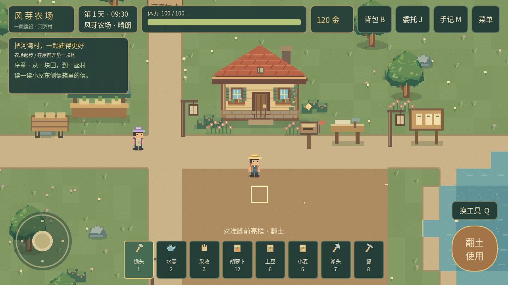
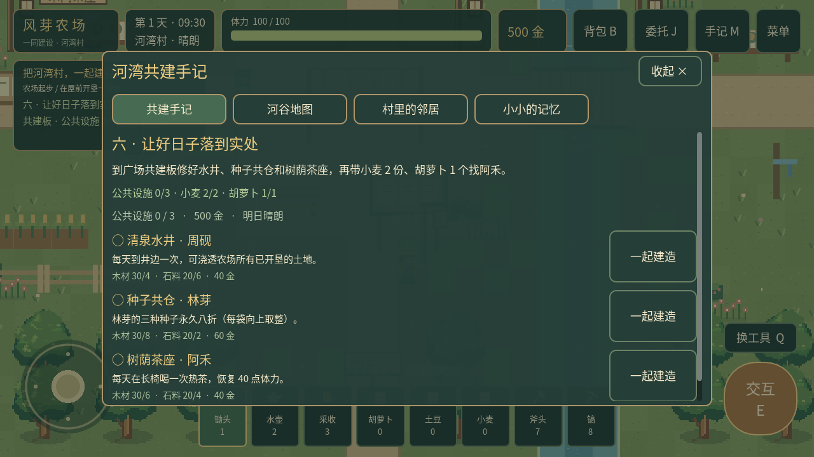

# Pixel Farm · 风芽农场

Godot **4.3 Standard** / GDScript 编写的原创 2D 像素农场 RPG 原型。横屏 1280 × 720，32 × 32 地图格，Compatibility 渲染，60 FPS 目标。无需插件、.NET、Python 或联网即可运行游戏。

当前版本为 **0.3.0「共建河湾」**：主线以和村民一起建设更好的村庄为基础。已完成可玩第一章：农场供菜、修桥、阅读共建计划、修建水井/种子共仓/茶座、聚餐与风灯之夜。新增河湾村地图、三位原创角色、对白选择、建设福利、手记地图、细雨天气、原创配乐和场景细节。0.1/0.2 存档可迁移，经营进度保留，新增剧情从来信开始。完整更新见 [版本记录](docs/CHANGELOG.md)。

查看 [开发进度与完成情况](docs/PROJECT-STATUS-0.3.0.md)，了解当前可以玩到哪里、各系统完成范围、交付结果和后续开发内容。





源码、进度文档和截图保存在仓库中；APK、校验文件和源码压缩包通过 [GitHub Releases](https://github.com/xjbalance/PixelFarm/releases/tag/v0.3.0) 下载。本地 `.tools/`、`.godot/`、签名私钥和构建缓存不上传。

## 立即运行

### Windows

1. 下载并解压 [Godot 4.3 Standard Windows 版](https://godotengine.org/download/archive/4.3-stable/)，不要选择 .NET 版。
2. 在项目管理器中点「导入」，选择本目录的 [`project.godot`](project.godot)。请保留整个目录结构。
3. 等待字体、PNG、音频首次导入完成，按 **F5** 运行主场景。
4. 不需要安装插件、Android SDK 或重新生成素材，即可进行电脑测试。

命令行也可启动（替换实际引擎路径）：

```powershell
& "C:\Tools\Godot_v4.3-stable_win64.exe" --path "C:\Games\PixelFarm"
```

本次实际运行环境是 Linux，不是 Windows；Windows 导入与键盘流程已提供，Windows 实机尚未验证。

### 本次开发环境

工作区内已下载官方便携版引擎，可运行：

```bash
cd /home/xiznhi/xiangqi/PixelFarm
./.tools/Godot_v4.3-stable_linux.x86_64 --path .
```

该命令需要图形桌面。无桌面环境请使用后文的无界面测试。`.tools/` 是本地验证工具，不属于源码压缩包，也没有安装到系统。

## 操作与第一份收获

| 操作 | 电脑 | 手机 |
|---|---|---|
| 移动 | WASD / 方向键 | 左下虚拟摇杆 |
| 使用工具 / 附近交互 | E / 空格 | 右下「使用 / 交互」按钮 |
| 选择工具 | 1—8，Q 循环切换 | 点工具栏或「换工具」 |
| 背包 | B / Tab | 右上「背包」 |
| 查看委托 | J | 右上「委托」 |
| 共建手记 / 地图 / 人物 | M | 右上「手记」，长列表可上下滑动 |
| 菜单 | Esc | 右上「菜单」 |
| 保存 / 读取 | F5 / F9（游戏窗口内） | 菜单中的对应按钮 |
| 对话继续 / 选择 | E 显示全文或继续；数字键选择 | 「继续」/「记下这句话」，点击回答选项 |

工具顺序：**锄头 → 水壶 → 采收 → 胡萝卜种子 → 土豆种子 → 小麦种子 → 斧头 → 镐**。

1. 从出生点向下走到小屋前的浅色土地。脚前的亮框是当前操作格。
2. 用锄头翻土；选择种子，再对同一格操作；换水壶浇水。
3. 走到屋门口按交互进入小屋，再走到右上方床的左侧，选择休息到明天。
4. 从屋内下方的门返回农场。每天浇水，胡萝卜需要 **2 个浇过水的生长日** 才成熟。
5. 切换「采收」对成熟作物操作。收获进入背包，不会自动出售。
6. 农场西北方有种子摊，靠近摊位交互即可购买种子、出售全部同类收获。林芽站在摊位东侧，可单独交谈。

初始拥有 120 金、100 体力、12 袋胡萝卜种子、6 袋土豆种子和 6 袋小麦种子。翻土消耗 2 体力，其余成功的农活消耗 1；失败操作不消耗资源。水壶不需要补水。采集每次消耗 3 体力，修缮卧室后体力上限提升到 130。

| 作物 | 种子价格 | 收购价 | 需要浇水的生长日 |
|---|---:|---:|---:|
| 胡萝卜 | 12 | 36 | 2 |
| 土豆 | 18 | 56 | 3 |
| 小麦 | 8 | 22 | 2 |

一天从 06:00 到 24:00，每现实秒经过 2 游戏分钟（完整一天约 9 分钟）。睡觉或午夜触发一次成长；没浇水的作物暂停成长，不会枯死。第 4、7、11、14……天有细雨（每七天循环），会为新的一天补水；其余天浇水状态重置；体力恢复至当前上限（100，修缮卧室后为 130）。对话、背包、商店、菜单和后台期间暂停游戏时间。当前日期为累计天数，尚无四季日历。

## 共建河湾：可玩第一章

这是温馨村庄故事的第一章，已能完整从来信玩到结尾；还不是多年内容量的完整商业 RPG。

- 姨婆的信：选择你想怎样参与村庄生活。新档会自动展开；旧档从小屋东侧信箱开始。
- 林芽：种出三个胡萝卜，接上农场与茶屋的供菜，得到 50 金。
- 周砚：沿农场北侧路牌进村，备好木材 8、石料 6，共同修复旧桥。桥面和真实碰撞一起改变，随后可以到河东。
- 建设簿：去风车了解三位村民的愿望，再到广场南侧「河湾共建板」施工。顺序自由，远程手记只能查看。
- 阿禾：三项公共设施全部建成后，交付小麦 2、胡萝卜 1，共同吃一顿饭。
- 风灯之夜：18:00 后到广场。旁边长椅可等待到傍晚。最终选择改变风灯装饰和村民后续对白；获得 120 金。

| 公共设施 | 材料与费用 | 实际用途 |
|---|---|---|
| 清泉水井 | 木材 4、石料 6、40 金 | 每天到井边引水一次，浇透所有已开垦农田；首次查看井边刻痕后再次交互可引水 |
| 种子共仓 | 木材 8、石料 2、60 金 | 种子永久八折，每袋金额向上取整：胡萝卜 10、土豆 15、小麦 7 金 |
| 树荫茶座 | 木材 6、石料 4、40 金 | 长椅每日可喝茶恢复 40 体力；满体力时不浪费额度 |

共建总计木材 18、石料 12、140 金；修桥另需木材 8、石料 6。林芽保管种子，周砚负责木作，阿禾经营茶屋；他们的对白会随建设、天气、时间和选择变化。风灯夜会在广场相聚，但尚未实现完整寻路日程。

`M / 手记` 提供目标、物资进度、地图、人物和三段可探索的村庄往事。地图白点是玩家，金环是当前目标；地图不会传送角色。

默认启用操作辅助：面对已种且缺水的作物，动作键自动浇水；面对成熟作物自动收获。斧头、镐保留原动作。菜单可关闭辅助，选择会保存。退出对白不会提交材料或推进章节；读完末句才结算。

## 采集、修缮和委托

选斧头面向树干，或选镐面向石堆，按 E / 右侧按钮采集。目标会显示边框与耐久条；资源采完直接进入背包，角色可以走过留下的树桩或碎石。

| 资源 | 普通工具需要次数 | 获得材料 | 再生时间 |
|---|---:|---:|---:|
| 树木 | 3 | 木材 ×4 | 3 天 |
| 石堆 | 2 | 石料 ×3 | 2 天 |

再生发生在换日。如果玩家站在再生位置，会延后到下次满足安全条件的换日。剩余耐久、枯竭状态与再生日期都会保存。背包「木材与石料」页可查看数量、装备对应工具；种子摊同一页可出售，木材 4 金/份、石料 5 金/份。

小屋东侧的 **修缮台** 提供三项永久升级：

| 设施 | 消耗 | 效果 |
|---|---|---|
| 精制工具架 | 120 金、木材 8、石料 9 | 斧头/镐每次 2 点伤害：树木 2 次、石堆 1 次完成采集 |
| 田边引水渠 | 140 金、木材 12、石料 6 | 自动浇灌农田西北 4×3 格（蓝色边框范围），建成/区域内翻土时也立即供水 |
| 温暖的卧室 | 160 金、木材 16、石料 6 | 体力上限升至 130，下次睡觉恢复至新上限，室内床铺同步改变 |

引水渠每天先按昨夜浇水状态结算成长，再为新的一天补水。区域之外仍需手动浇水，作物不会因为修建而立即成熟。

修缮台更东侧是 **河谷委托板**。先接取，备齐物品后回板前交付；J / 右上「委托」随时查看进度。交付会消耗物品，奖励只领取一次，下一份委托在上一份完成后开放。

| 委托 | 交付物品 | 奖励 |
|---|---|---|
| 第一份心意 | 胡萝卜 3 | 80 金、土豆种子 3、好感 +15 |
| 修补河畔小路 | 木材 8、石料 6 | 120 金、小麦种子 6、好感 +20 |
| 河谷的晚餐 | 土豆 3、小麦 4 | 180 金、胡萝卜种子 6、好感 +25 |

林芽每天首次交谈额外增加 2 好感；达到 25 和 60 时关系称呼改变。当前好感上限为 100。奖励装不下、金币封顶或交付物品不足时，整笔操作会被拒绝，原有资源保持不变。

## 存档

使用 `user://farm_save.json`，上一次版本保存在 `farm_save.json.bak`。首次运行直接开始新游戏，之后自动尝试读取；也可通过菜单或快捷键手动保存、读取。

保存位置、所在场景、日期和时钟、体力、金币、背包、工具选择、所有农田与作物状态、引导进度、音乐与音效开关、采集资源状态、设施、委托和好感。睡觉、换日、应用进入后台，以及修缮/接取/交付/当日首次交谈后自动保存。先写临时文件再更名；读档完整校验后才修改游戏，主文件损坏时尝试备份。

新版本会在内存中迁移版本 1 / 2 存档，保留原位置、农田、金币、背包及已有设施委托；下次保存写入版本 3，原文件成为 `.bak`。版本 3 另存主线、选择、发现、操作辅助、公共设施和每日引水/喝茶次数。无需删除存档或重开游戏。

在编辑器的「项目 → 打开用户数据文件夹」中可找到存档。Windows 默认位于 `%APPDATA%\Godot\app_userdata\Pixel Farm · 风芽农场\`；Android 使用应用私有存储，不申请外部存储权限。卸载应用会删除数据。

## 目录与扩展

```text
PixelFarm/
├── project.godot                 # 可直接导入
├── export_presets.cfg            # Android Debug / Windows Desktop
├── scenes/
│   ├── main/                     # 主场景
│   ├── world/                    # 农场、小屋、河湾村
│   ├── player/                   # CharacterBody2D 与相机
│   ├── npc/                      # 林芽、周砚、阿禾（同一可配置场景）
│   ├── farming/                  # 农田视图
│   └── ui/                       # HUD
├── scripts/
│   ├── core/                     # 信号、会话、场景协调、音效
│   ├── player/ world/ farming/
│   ├── inventory/ npc/ economy/
│   ├── gathering/ progression/   # 采集资源与设施/委托
│   ├── story/ presentation/     # 共建剧情、公共设施、气氛表现
│   ├── time/ save/ ui/
├── resources/crops/              # CropDefinition .tres
├── resources/story/             # 共建主线、选择、村庄工程 JSON
├── resources/dialogue/           # 中文 JSON 对话
├── resources/items/              # 木材与石料定义
├── resources/progression/        # 设施与任务 JSON 定义
├── assets/                      # 原创像素图、音效、中文字体
├── tests/                       # 真实引擎集成测试和截图场景
├── tools/                       # 验证、素材生成、Android 预检
├── docs/                        # 设计、来源、验证、导出说明
└── builds/                      # APK、校验文件、源码包与本地日志
```

地图通过 `farm_world.gd` 在运行时填充原生 `TileMapLayer`，因此编辑器内静态地图预览为空，运行后自动生成。池塘用 TileSet 物理层；建筑、树木、石头使用实体碰撞；角色与物件按 Y 坐标排序。农田以坐标字典保存，绘制与规则独立。

增加作物时，创建新的 `CropDefinition` 资源、在 `catalog.gd` 登记，并扩展作物图集；种子若需要快捷入口，再更新工具栏列表。成熟天数和售价由资源决定。独立 NPC 场景与对话 JSON 便于扩展角色。跨系统使用 `Events`、`Inventory.changed`、`GameClock.day_advanced` 等 Signals，详见 [架构说明](docs/ARCHITECTURE.md)。

## 验证

Python 只用于自动化测试入口，不是游戏运行依赖。安装 Godot 4.3 后：

```powershell
python tools/check_project.py --godot "C:\Tools\Godot_v4.3-stable_win64_console.exe"
```

或在本次 Linux 环境：

```bash
python3 tools/check_project.py
```

该入口使用隔离临时用户目录，依次做编辑器导入、240 项玩法集成断言、独立进程的新状态读档和旧存档迁移、主场景 180 帧启动检查，并检查退出码和错误日志。手动最小检查：

```bash
godot --headless --editor --path . --quit
godot --headless --path . --quit-after 180
godot --headless --path . res://tests/runner.tscn
```

实际检查结果与限制见 [验证报告](docs/VALIDATION.md)。`docs/screenshot-*.png` 是 Godot OpenGL 实际渲染截图；成长示意截图由测试场景布置作物，不代表新游戏自带成熟作物。

## Android

已配置横屏、Compatibility、arm64-v8a + armeabi-v7a、原生触摸摇杆、独立触点按钮、自适应布局和安全区处理。关闭「触摸模拟鼠标」，避免多指争用同一个鼠标事件；电脑版鼠标点击仍可使用。

**APK 已生成**：[风芽农场 0.3.0「共建河湾」调试版](https://github.com/xjbalance/PixelFarm/releases/download/v0.3.0/PixelFarm-0.3.0-debug.apk)，支持 ARM64/ARMv7、Android 5.0 及以上和 OpenGL ES 3.0。将 APK 传到手机，点击文件并按系统提示允许该来源安装应用即可。无需在手机安装 Godot。

已通过签名、包名、启动入口、ZIP 完整性和对齐验证；APK 内的实际游戏资源也已在桌面引擎独立启动。尚未进行 Android 真机安装运行测试。当前 Linux 工作区运行 `python3 tools/build_android.py` 可复用本地工具和签名重新打包。详见 [Android 导出与真机验收](docs/ANDROID.md) 和 [APK 构建报告](docs/APK-BUILD-0.3.0.md)。

新版使用与 0.2.0 相同包名和签名，可覆盖安装；请保留应用数据，不要先卸载旧版。旧版安装包仍保留在 builds。

## 当前完成情况

| 状态 | 内容 |
|---|---|
| 已实现并验证 | 农场探索、四向移动与动画、物理碰撞、镜头跟随、触点摇杆和按钮、种田循环、体力、林芽多句对话 |
| 已实现并验证 | 三种作物、堆叠背包、工具选择、种子购买与收获出售、日期时钟、睡觉与每日结算 |
| 已实现并验证 | 小屋场景切换、昼夜调色、JSON 保存/恢复/备份校验、跨进程读档、后台输入处理 |
| 已实现并验证 | 采集/耐久/掉落/再生、材料出售、三项设施升级、三份连续委托、每日交谈好感、八格工具栏、旧存档迁移 |
| 已实现并验证 | 河湾村、三位角色的完整首章、双选项、修桥通行、三项共建及福利、地图手记、探索记忆、天气与情境操作 |
| 已实现，部分验证 | 48 秒原创循环主题、循环雨声、农活粒子、场景过渡、萤火与风灯；音频资源和播放状态验证，未进行人工听感验收；安全区与多指为模拟输入验证 |
| 已生成并验证 | Android 调试 APK、ARM64/ARMv7 双架构、签名与安装包完整性、最终 APK 资源脱离源码启动 |
| 尚未验证 | Windows 实机、Android 触屏真机、实际刘海/手势导航栏、60 FPS 真机性能、电量和内存表现 |
| 未完成 | Windows EXE 导出、后续主线章节、完整 NPC 寻路日程、四季生态、畜牧钓鱼和更大规模地图 |

后续章节可围绕河岸改善、农产品集市与新居民定居继续扩展；当前实际内容以本 README 和验证报告为准。

## 参考与素材来源

已检查指定仓库，另调查 MIT 开源的 Harvest-Moon-2.0、Seasons Gone 和 Dialogue Manager（兼容 4.3 的 v3.3.3）。参考地图、天气和条件对白组织方式，游戏代码、剧情和美术独立实现，没有直接移植插件或未明确许可的资源。版本与许可证记录见 [参考仓库调查](docs/REFERENCES.md)。

像素角色、地图、建筑、作物、图标和音效由本项目独立生成，没有使用《星露谷物语》原始内容。字体为 Noto Sans CJK，许可证随工程提供，详见 [素材来源](docs/ASSET_PROVENANCE.md)。
