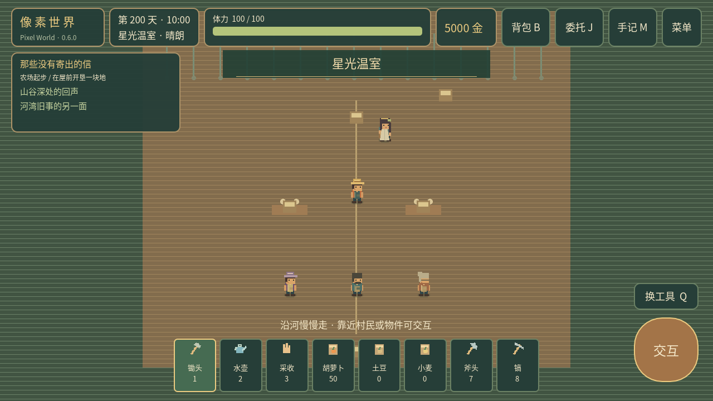
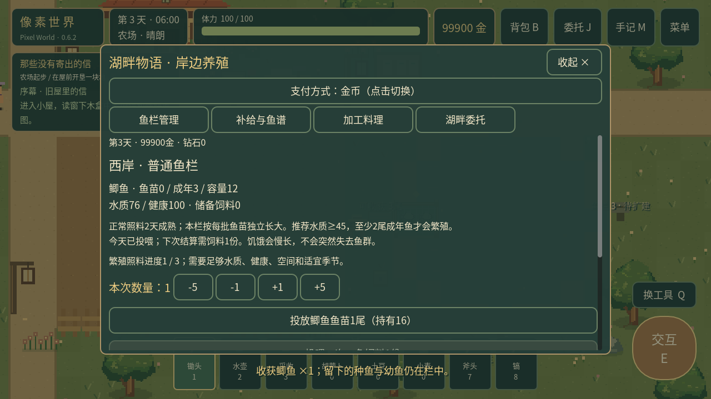
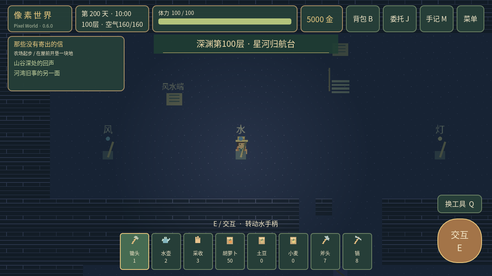

# 像素世界 · Pixel World

当前工作区正在开发 **0.7.0《四季万象》**，阶段 A–C 已接入，当前开发schema v18。**整个0.7.0尚未完成**。已接入钓鱼、畜牧、生态与厨房加工，四节日、NPC个人事件与扩建装修已接入，阶段D/E继续隐藏地图、世界发展与最终验收。

开发分支 `development/0.7.0`；原0.6.2全部未提交内容已保留为恢复提交 `3968f07`。每阶段验证后提交，不向外发布拆分版本。进入手记点击“四季历”，可查当前年份、季节日期、七日预报和村庄已有改变。绝对日数与婚后纪念计数保留，冬季胡萝卜/土豆休眠，小麦全年。

[0.7.0阶段进度与继续开发信息](docs/PROGRESS-0.7.0.md) · [阶段A测试证据](docs/VALIDATION-0.7.0-A.md) · [阶段B与操作修复](docs/VALIDATION-0.7.0-B.md) · [阶段C生活家园](docs/REPORT-0.7.0-C.md)

---

以下为上一个完整交付 **0.6.2《湖畔物语》** 的玩法与验证记录。


Godot **4.3 Standard** 原创像素经营RPG，当前 **0.6.2《湖畔物语》**。保留农场、三张原图、第一章、原矿区、NPC和旧存档，保留完整100层深渊、第二章16项、独立温室婚礼与小京终局/婚后内容，在农场原湖泊新增可玩的养殖经营。

Android默认点击移动、自动寻路和智能交互，设置随时切换备用摇杆并保存。20点前禁止睡眠，午夜疲劳只恢复60%，日结算一次。**1823项自动化零失败；调试APK已构建，真机尚未验收。** [完整报告](docs/REPORT-0.6.2.md) · [测试记录](docs/VALIDATION.md)



## 运行

使用 Godot 4.3 Standard 导入 [project.godot](project.godot)，等待素材导入后按 F5。不需要插件或 .NET，游戏运行不依赖 Python。Windows 可直接导入；Windows EXE 和 Windows 实机尚未验收。

当前 Linux 工作区：

```bash
./.tools/Godot_v4.3-stable_linux.x86_64 --path .
```

`.tools/` 只供本机构建验证，不打进源码包。本次已导出[Android调试APK](builds/PixelWorld-0.6.2-debug.apk)，原包名与签名保留；尚未真机安装验收。当前工作区可继续开发。

## 操作

| 操作 | 电脑 | 当前 Android |
|---|---|---|
| 移动 | WASD / 方向键 / 鼠标左键 | 点击地面自动寻路；备用摇杆 |
| 工具 / 靠近交互 | 点击目标 / E / 空格 | 点击人物、田地或物件，靠近后自动执行一次 |
| 工具选择 | 1–8 / Q | 工具栏 / 换工具 |
| 背包 / 委托 / 剧情手记 | B / J / M | 右上对应按钮 |
| 菜单 | Esc | 右上菜单 / 系统返回 |
| 保存 / 读取 | F5 / F9（运行窗口中） | 菜单 |

工具依次为锄头、水壶、采收、胡萝卜种子、土豆种子、小麦种子、斧头、镐。默认点击田地自动翻土、为已播种作物浇水、收获成熟作物；空田按选中的种子播种。工具栏的主动选择优先用于下一次点击，之后恢复智能判断，菜单可关闭辅助。树石每次点击只采集一下。菜单中的操作方式可自由切换，切换立即清空旧移动与交互，重启恢复选择。详见[点击操作说明](docs/TOUCH-CONTROLS.md)。

初始120金、100体力、胡萝卜种子12、土豆种子6、小麦种子6。屋前浅色土地可耕种：翻土→选种子播种→浇水→回小屋休息，按需连续照料后收获；收获不自动出售。胡萝卜/土豆/小麦分别需要2/3/2个浇过水的生长日；种子12/18/8金，收购36/56/22金。失败操作不扣资源。背包每类普通物品上限999。

一天06:00–24:00，现实每秒走2游戏分钟。**20:00前不能睡觉**；20:00–23:59确认睡到次日06:00并全恢复；午夜疲劳昏睡只恢复60%体力，统一结算一次。对话、背包、商店、菜单及后台暂停时间。第4、7、11、14……天细雨，先结算昨夜成长再补新一天雨水。缺水暂停成长，不会枯死。翻土耗2体力，其他成功农活耗1；砍树/采石每次耗3。

## 第一章：河水带走的名字

1. 进小屋，读窗下木盒里的旧信和残缺地图；农场信箱也能读信与回顾。
2. 找林芽，完成种植、浇水和收获教学，交付三个胡萝卜，获得50金。
3. 北面路牌进河湾村，调查**桥西水位牌**和**木作坊檐下维修记录**，再与周砚交谈。
4. 与阿禾读茶屋留言册，了解居民为何离开；备木材8、石料6，在桥头一起修桥。
5. 步行过桥探索东岸，读风车货运簿。风车旁旧货箱可读两条不同便条。
6. 在共建板修好水井、共仓和茶座，回去找阿禾。这里通过生活变化推进，无须再交一批食材。
7. 18:00后到风灯架，选择农业贸易、自然探索或居民生活；长椅可等到傍晚。

三个方向分别奖励胡萝卜种子3、小麦种子6、土豆种子3，另有原有120金庆典奖励。选择改变第二章起步任务的推荐顺序与对白，**三个方向的起步任务全部开放**；第二章已接入16项连续任务；矿道与深渊后续内容见下文。

林芽白天经营农场种子摊，傍晚去广场/茶座；周砚工作时去木作坊或桥边；阿禾午间会使用已修好的水井，傍晚去茶座。人物手记有活动位置提示。NPC采用少量固定站点和四向网格移动，对话时停下；风灯装饰持续保留。

| 公共设施 | 费用 | 效果 |
|---|---|---|
| 清泉水井 | 木4、石6、40金 | 每日一次浇透已开垦农田 |
| 种子共仓 | 木8、石2、60金 | 种子八折，每袋向上取整 |
| 树荫茶座 | 木6、石4、40金 | 每日热茶恢复40体力，满体力不浪费次数 |

原有农场工具架、引水渠、卧室升级和三份河谷委托继续保留。树木3次掉木4、3日再生；石堆2次掉石3、2日再生；工具架提高伤害，再生会避开玩家。卧室使体力上限130，引水渠自动照料西北4×3格。

## 0.6.2 湖畔物语

农场东湖岸新增四处鱼栏，西/南初始可建，升级后开放东/北。点击木牌/鱼栏自动靠岸，也可摇杆靠近按交互；原湖水不可行走。一级木10、石6、100金，容量12尾；二/三级容量20/32，升级保留鱼群。林芽种子摊新增“鱼苗与湖鲜”，原修缮台可查看鱼栏图纸。

六种鱼：鲫鱼/鲤鱼/草鱼/鲈鱼/金鳞鱼/星辉鱼，适宜条件下2/3/4/5/8/12日成长。逐批鱼苗、每日投喂、水质/健康、容量约束繁殖、部分收获保种、储备自动喂食、鱼类加工料理与三委托均可操作。小京有可选三日湖畔合作，羁绊+3一次；不取代原终局条件。

[养殖玩法与六鱼数据](docs/AQUACULTURE.md) · [经济模型](docs/AQUACULTURE-BALANCE.md) · [版本报告](docs/REPORT-0.6.2.md)



## 已有0.6.1稳定性改进

修复长椅反复快进、试炼终点空气事后补算、同帧保存刷掉备份、加载/退出交互边界、静音阻止婚礼走位；调整有用礼物轮换。八处可选侧廊保留原主路，产量/掉率不降低。Debug版本新增可关闭的本地试玩记录，不联网、不进正式存档。

[稳定性总结](docs/REPORT-0.6.1.md) · [经济前置模型](docs/ECONOMY-0.6.1.md) · [关卡审计](docs/LEVEL-AUDIT-0.6.1.md) · [本地诊断](docs/DIAGNOSTICS-0.6.1.md)

## 已有0.6.0 星河之约内容

百层分为1–20废弃矿道、21–40地下水脉、41–60晶石洞窟、61–80远古遗迹、81–100星辉深渊。每10层检查点，每20层独立多阶段机关；第100层为三轮信标与独立星核室。完成第二章首次开放讨论并取得星纹镐后，从原晶石洞窟西南升降机进入。七级护具、空气补给、预警/安全设施、矿物与自然再生、一次箱均保存。

第二章《山谷深处的回声》完成16项：三位主线NPC提出农业、检修、口述需要，玩家调查20/40/60层、种植、加工器件，再在告示板决定政策并完成交接。小京不是主线前置，第三章目前仅留下远途信使伏笔。

《第1314颗星星》保留520播种、三属性100、12任务、7记忆、5试炼、五阶段温室与1314钻石。七记忆各有调查机制和情绪反馈；强化深渊80–100、回路20→60→100、联合考察100层。婚礼从农场档案桌进入独立礼堂，左桌准备、右桌最终确认才扣1314；中断恢复不重扣。新婚后留种与外出项目、季末节日，以及原日程/季节/纪念/婚后520日回信保留。



## 存档与Android交付

当前schema **v11**，兼容v1–v10，保留原经营、剧情、关系、钻石、婚姻和操作模式；原20层与旧5/15检查点不清空。仍用`user://farm_save.json`和`.bak`，更名后的旧用户目录保持。普通商店不能购买钻石；已有商品/服务可选钻石支付，新材料按区域解锁，取消不扣。旧已确认婚约继续有效。

[PixelWorld-0.6.2-debug.apk](builds/PixelWorld-0.6.2-debug.apk) · [SHA256](builds/PixelWorld-0.6.2-debug.apk.sha256)。包名org.pixelfarm.windbud、原证书不变，code9，双架构。构建/签名/对齐/数据校验和APK资源桌面启动通过，**不等于Android真机或覆盖安装通过**。

```bash
python3 tools/check_project.py
python3 tools/check_060_layouts.py
python3 tools/simulate_aquaculture.py
python3 tools/simulate_061.py
python3 tools/audit_061_levels.py
python3 tools/build_android.py
python3 tools/verify_apk_runtime.py
```

项目内便携JDK/SDK由构建入口隔离配置，不自动下载、不替换原签名。完整玩法、流程与交付见：

- [0.6.2湖泊养殖报告](docs/REPORT-0.6.2.md)
- [已有0.6.1稳定性开发报告](docs/REPORT-0.6.1.md)
- [自动化与性能证据](docs/VALIDATION.md)
- [存档迁移](docs/SAVE-MIGRATION.md)
- [Android构建和真机清单](docs/ANDROID.md)
- [小京六幕与十二任务](docs/XIAOJING.md)
- [更新记录](docs/CHANGELOG.md)
- [经济模型与分项时间](docs/ECONOMY-0.6.1.md)

地图、角色造型、音乐为项目原创程序像素绘制/合成，沿用原素材体系。[素材来源](docs/ASSET_PROVENANCE.md)。目前未验真人长线时长、Windows实机和Android长时表现；200–350小时目标未验证，不用数学模型冒充真人试玩。0.5等文件是历史阶段报告，以0.6.2当前报告为准。
