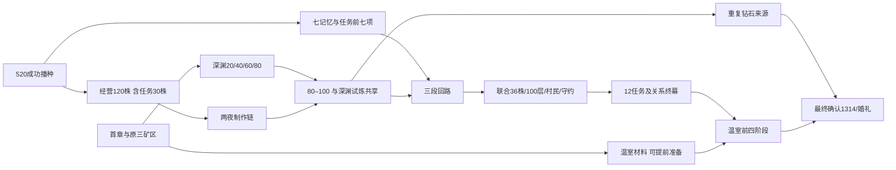

# 0.6.1《稳定与平衡》经济与难度审计

生产输入来自作物tres、矿物/配方JSON、100层地格、十二任务与试炼规则；每类玩家10,000次，共30,000次。操作、阅读、绕路、设施取得时机和拜访频率是明示假设；不是真人试玩，也不是求得可行最优排程的证明。

## 36小时与长期目标差距的原因

- 0.6.0模型用主线/关系10–24h、试炼3–7h、百层3.5–6.5h的宽泛假设，未计算520播种与关系成长的真实前置；不能视为实测基线。
- 十二任务和五强化徽记等一次性奖励合计提供好感83、信任107、羁绊102（含拼接、关系事件与守约）。后三者受阶段约束，但并不需要独立刷100天；关系通常与任务同时完成。
- 原矿区付费重勘是合法效率路线：实际消耗补给、燃料、作物并受体力和加工队列约束，不能当成复制奖励漏洞。新模型把它纳入效率型选择。
- 首次百层与80–100试炼、管理120株与任务30株、七记忆与调查任务都可共享行动，不能重复计时；自然再生与作物成长可在其他工作期间发生。
- 发现的长椅快进确实能绕过每日多数时间，现限于首章庆典一次；原0.6模型本来就按正常日长计算，因此封堵漏洞不应被宣传为模型人为增时。

## 三种玩家结果（小时）

| 类型 | P10 | P50 | P90 | 钻石策略 |
|---|---:|---:|---:|---|
| 效率型 | 17.67 | 18.20 | 19.95 | {'paid_original': 10000} |
| 正常型 | 21.91 | 24.96 | 28.00 | {'all_rare': 10000} |
| 探索型 | 31.55 | 36.34 | 41.23 | {'all_rare': 10000} |

效率型按攻略、充分利用补给重勘与工作空档；正常型兼顾读文本和多种矿料；探索型更多绕路、读记录和查看分岔。固定保底与固定日长会使某些模型区间很窄，不代表实际时间精度高。

## 八个分项：P50与重叠关系

下表的“到达时刻”来自前置图的最早完成估计；总时间另受单玩家主动工时下界约束，不能将表内时刻相加。

| 分项 | 效率型 | 正常型 | 探索型 | 含义/前置 |
|---|---:|---:|---:|---|
| 新游戏→成功播种520 | 2.33 | 3.20 | 4.50 | 初始120金/24种子，合法地块、成长、雨水、体力、设施和资金模拟；约20/24/30游戏日 |
| 解锁→三属性100 | 2.17 | 2.92 | 3.99 | 包含任务/试炼奖励前置及每日互动；不是另加一段刷礼时长 |
| 解锁→12任务与7记忆完成 | 2.17 | 2.91 | 3.93 | 后五任务依赖试炼，和下一行共享过程 |
| 五试炼窗口 | 2.13 | 2.83 | 3.79 | 解锁后到联合考察完成；种植30包含在120、深渊共享最后21层 |
| 新游戏→第100层 | 3.96 | 5.40 | 7.27 | 主线矿区/装备、80层准备、合法末段路线 |
| 钻石重复获取主动工时 | 11.70 | 14.56 | 20.86 | 采矿、往返、原料、加工；不含并行等待 |
| 新游戏→钻石条件的前置时刻 | 17.57 | 19.96 | 28.13 | 依赖高级进度，扣除按探索比例取得的一次奖励，计补给/体力/刷新周期 |
| 温室材料与施工主动工时 | 0.83 | 1.26 | 1.80 | 可提前备料，结构须12约定；最终星灯与婚礼同笔结算 |
| 前四阶段准备完成时刻 | 4.60 | 6.29 | 8.59 | 第五阶段仍等1314钻石最终确认 |
| 全部条件及第五阶段/婚礼 | 18.20 | 24.96 | 36.34 | max(依赖关键路径,单玩家全部唯一主动工时)，含最后仪式 |

前置图与独立主动工时相互约束，但未精确模拟每次界面暂停、交错行程、每个库存峰值或所有失败选择。资料不足之处使用假设，需新的本地日志校准。

## 来源、工具与单位收益

| 来源 | 长期产出/限制 |
|---|---|
| 原三矿区钻石矿 | 平均3.75钻/三日；固定每四矿额外1，无读档重掷 |
| 原三矿区星辉精炼 | 9原矿→6钻/一轮，另付晶石/木材，次日领取 |
| 高阶实地委托 | 5钻/三日，需本轮新采三高级矿并交真实物资 |
| 原矿区付费重勘 | 六高级矿耗尽后付麦8木8铁锭1合金1；基本9.75钻/轮，稳态补给/燃料/作物/委托约216体力/日，仍受加工限制 |
| 旧16–20支线 | 20原矿可精炼约13.33钻/三日；需采尽+付补给 |
| 81–100钻石矿 | 20矿平均25钻/三日；无需一次奖励仍可重复 |
| 41–80原矿 | 80原矿理论精炼约53.33钻/刷新；全稀有+燃料/晶石至少867体力，不能假设一天收完 |
| 所有一次箱与记忆遗匣 | 上限80钻，约占1314的6.09%；不能刷新/迁移重发 |

完整每层数据见BALANCE-0.6.1.json的floors：入→矿→出的格数、步行秒数、3击/9体力、每刷新日钻石等价、每实际操作游戏小时等价。游戏1小时=现实30秒；单位主动收益不含跨层、加工和补给，不能当全局每小时刷钻率。普通矿区工具等级效率见tools字段；例如普通镐铁矿4击/12体力，强化/星纹镐2击/6体力；高级钻石原矿区约16体力/钻，深渊约7.2体力/钻，体现高层投入后的收益。

主线金币奖励：首章170、第二章580，原农场委托380。它们缓解种子/设施资金，不直接替代1314钻石。一次性关系奖励较大，是目标时长短于数百小时的明确设计原因。

## 死局与200–350h评估

作物从初始资金/种子可持续扩大；设施材料在农活剩余体力预算内获取。护具的铜纹片和残晶均在升级所需深度之前可采；加工队列满包不丢产出；无随机无保底的必要材料。全部箱子耗尽后仍有自然再生、精炼、委托与付费补给路线。错误机关可重试、检查点不清除，侧廊可不用，主路保留。静态与规则检查未发现必然资源死锁，但不代替真人从零全程库存审查。

不建议把当前流程硬调到200–350h。现有内容不足以让额外约160–330h保持差异；仅拉低产出、限制睡觉或加次数会主要增加重复劳动/等待。本轮不改掉率，优先封堵异常、改善路线和采集真实数据。0.7应先加可选的策略变化、委托组合和角色活动，再依据试玩决定合理时长。
