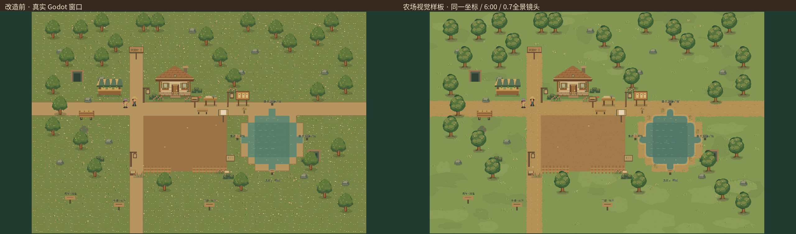
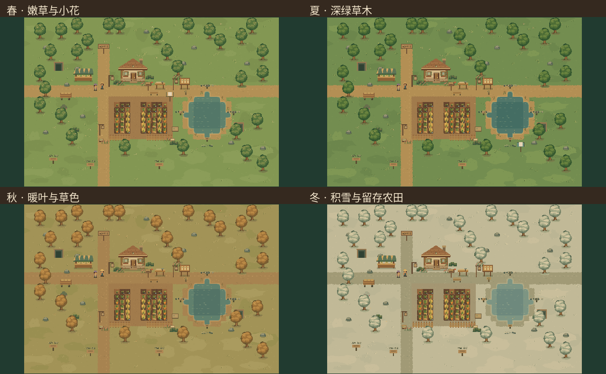

# 农场地图视觉样板 06

基于`0ac1b78`，本轮只重绘农场的地面与可砍树显示，不重做村庄、森林、矿洞或湖泊独立场景。方向为温暖、细腻、自然的像素田园：减少旧版满屏细碎草花，用低对比草块、成簇植被、自然路缘与统一光照建立层次。它是供玩家查看的农场视觉样板，不以截图宣称已达到商业游戏的全部美术完成度。

## 实际使用的素材

`assets/farm06/`共18张原创PNG，由`tools/generate_farm06_assets.py`使用Pillow在原生像素尺寸绘制：四季1536×1024地面图、三种冠幅×四季的12张80×104树图、两张32×32干湿土。运行游戏不需要Python。保留项目原Noto中文字体与许可。

地面使用协调的草色和不规则浅深草块；主路保留原走向，增加细碎土纹、断续车辙和不规则边缘。树下有浅根土与细草；少量野花、碎石集中成簇，避免旧版均匀散点噪声。原池塘周围增加浅岸线、像素圆角和芦苇。圆角通过二值几何遮罩绘制，最终图像没有模糊插值。

树木保留原画布、脚底、资源ID和碰撞，按稳定资源ID选择三种冠幅变体；使用统一西北侧亮面、连贯树冠块面与稀疏叶片。春季嫩绿小花、夏季深绿、秋季暖叶、冬季积雪。干湿土地用同一套垄沟像素语言区分，作物阶段与水花/收获反馈沿用现有资源。

参考只用于信息组织、草块密度和树冠层次研究。实际查看了开发目录中的Cainos Basic预览；没有把商业图像或`need/`参考原图复制进工程。其他参考页面和图片访问情况见整合报告，不声称看过未打开的素材。本轮没有调用AI图像API或下载商业瓦片包。

## 分层与业务保护

| 层级 | 实现与职责 |
|---|---|
| Ground | 原`TileMapLayer`，z=-5，48×32格、32px网格、8类atlas坐标及水碰撞保留 |
| GroundDetail | 新`FarmVisual06`，z=-4，一张缓存地面Sprite；只在季节改变时换图，不逐帧重扫全图 |
| Objects | 原`FarmPlots`在z=-1绘制干湿土与作物；原Actors继续Y排序建筑、树石、人物与设施 |
| Effects / 前景 | 原天气、水波、农活反馈与树冠/建筑前后遮挡继续使用已有层次，没有新增重粒子或Shader |

农场原1,536地面格逐格核对类型及物理多边形，未新增任何装饰碰撞。60块农田、30棵树、12处石堆、建筑入口、资源耐久和再生日期全部沿用原坐标与ID。`farm.gd`只调整`_draw`，没有修改播种、生效帧、体力、成长、收益或小京520计数规则。住宅四级外观仍由原`HouseExterior`按等级维护，入口和永久建设没有被底图替换成初始状态。

农场自己的旧草花散点在新底图出现时停止重复显示；村庄与其他地图继续使用原季节材质。再生只显隐原资源Sprite，不重建树；三种新树图在换季、采完和再生后都保留一致的像素锚点。原点击移动、自由观察和备用摇杆没有重写。

## 实际窗口截图

[前后同镜头对比](farm06/comparison.png) · [四季对比](farm06/four-seasons.png) · [新农场全景](farm06/panorama.png) · [完整截图清单](farm06/screenshots.json)





| 内容 | 截图 |
|---|---|
| 改造前基线 | [全景](farm06/before-panorama.png)、[住宅](farm06/before-home.png)、[农田](farm06/before-plots.png)、[道路](farm06/before-road.png) |
| 新住宅周边 | [home](farm06/home.png) |
| 新农田原始空地及作物阶段 | [plots](farm06/plots.png)、[crops_detail](farm06/crops_detail.png) |
| 道路与树木 | [road](farm06/road.png) |
| 春夏秋冬 | [春](farm06/season_spring.png)、[夏](farm06/season_summer.png)、[秋](farm06/season_autumn.png)、[冬](farm06/season_winter.png) |
| 四级住宅外观 | [一级](farm06/house_level_1.png)、[二级](farm06/house_level_2.png)、[三级](farm06/house_level_3.png)、[四级](farm06/house_level_4.png) |
| 实际横屏窗口 | [1280×720](farm06/layout_1280x720.png)、[1560×720](farm06/layout_1560x720.png)、[1600×720](farm06/layout_1600x720.png)、[1280×960](farm06/layout_1280x960.png) |

17张新画面均来自实际Linux Godot4.3 Xvfb/Mesa窗口，拼图仅整理这些真实帧。前后全景均为空田、相同坐标、06:00；0.7缩放仅为测试全景取图，正常游戏镜头不变。四季和作物细节图使用成长阶段夹具，不能作为真人完整种植流程或手机性能证据。

## 已执行验证

| 验证 | 实际结果 |
|---|---:|
| 修改前原季节/农活动作/三图资源状态 | 314项，0失败 |
| 修改前真实窗口与地面基线 | 1项，0失败，保存4帧 |
| 新样板状态专项 | 139项，0失败 |
| 新样板真实窗口专项 | 147项，0失败 |
| 修改后原季节/农活/资源状态 | 314项，0失败 |
| 修改后原农活/季节/资源窗口 | 203项，0失败 |

专项包括全部60格农田可达、42个资源合法采集面、实际路径进入家中、原翻土/播种/浇水/收获事务、重复收获拒绝、树石采完消失与到期再生、换季物理导航格完全一致、四级外观、四种横屏、完整旧状态恢复及原v24有效存档。成熟收获由明确的成熟夹具验证，真实成长规则另由原套件回归。

曾出现两项测试失败：测试把资源脚底所在32px交点的右下格当作阻挡格；资源恢复实际已成功。修正为核对真实collider、可见性与实体所在左上阻挡格后通过，没有改业务逻辑或降低碰撞要求。另修正新测试两处Godot类型推断错误；这些中间运行未计入通过结果。

最终专项日志：`builds/farm06-final-state.log`、`builds/farm06-final-render.log`；原套件回归：`builds/farm06-final-check.log`、`builds/farm06-final-window.log`。所有最终日志无脚本错误、FAIL或实例泄漏。测试使用临时用户目录，不触及真实玩家存档。

```bash
# 专项场景供标准回归入口调用。
# 无头专项：res://tests/farm_visual06_runner.tscn
# 真实窗口：res://tests/farm_visual06_render.tscn
python3 tools/check_project.py
python3 tools/check_windows.py --suite farm_visual06_render
```

## 修改文件与待验收

生产修改：`farm_world.gd`、新增`farm_visual06.gd`、仅农场视觉分支的`landscape_details.gd`和`season_landscape.gd`、`farm.gd`的土壤绘制；新增生成器、18张PNG与`tests/farm_visual06_*`。未修改存档schema、经济、主线、小京条件、地图坐标、全局相机或寻路算法。

没有Android真机，手机屏幕视觉、设备DPI、触控手感和内存/帧率仍待验收。当前样板保留原地理布局与设施比例，尚未对村庄、森林和矿洞做同级美术升级；后续须由玩家查看样板后再决定。

只读发现的旧问题：`WorldChanges.derive()`仍将住宅等级限定到3，等级4时其派生features可能为空。本轮未顺手修改该业务派生；农场实际住宅外观与入口由原模块正确维护，羊皮纸图纸直接读取真实系统状态，不依赖这份派生值。
