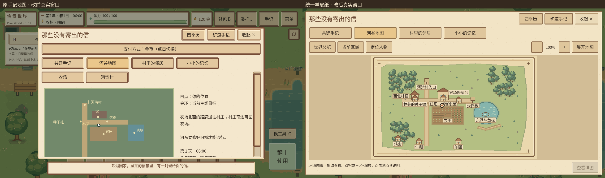

# 手记地图与羊皮纸界面统一

基于`96a9667`检查并修改原手记。此前“河谷地图”页仍使用独立的`FarmRiverMap`绘制绿色矩形、道路与圆点，和M键入口的新羊皮纸地图并存；570×350缩略图与右侧250宽说明也使内容超出旧滚动页，地图手势还会被外层`TouchScroll`认作滚页。

本轮将原入口直接接到同一套`FarmAtlasCanvas`、区域数据和羊皮纸资源。没有另建地图进度，也没有复制新的导航或场景坐标系统。

## 操作与返回

从HUD或菜单打开“手记”，选择原“河谷地图”页：

- “世界总览”看各地区；“当前区域”回到玩家所在场景；“定位人物”找到玩家标记。
- 单指拖动、双指缩放，或使用“＋／−”；点击地点看说明，再点“查看详图”查看已发现地区。
- “展开地图”交接到与M键完全相同的全屏地图，保留正在查看的地区。关闭全屏地图返回游戏；可从原手记按钮重新进入手记。
- 在手记内切换“共建手记”“村里的邻居”“小小的记忆”会恢复正文滚动；“收起 ×”、Esc及原关闭流程返回游戏。

手记地图页独立放在滚动正文旁，通过切换可见性显示：图纸没有`ScrollContainer`祖先，外层滚动隐藏时停止处理触点。切页或关闭会清理图纸手势，旧短提示也不会盖住地图的地点说明。地图只读，不能传送、自动操作或消耗体力。

## 页面与视觉

原四页、页签顺序、剧情文字、条件、建设费用和结算逻辑保留。共建项目、人物与记忆分组复用公共纸面卡片，标题和正文层次更清楚；人物头像采用88×96整数比例显示，与共享主题统一。

地图页通过`journal_map_open`元数据使用安全区内的大阅读面板，推荐上限1440×900；非地图页继续使用普通手记尺寸。地图标题、页签和工具按钮按现有`UIMetrics`换算触区，320/480 DPI注入样本分别验证64/96逻辑触控目标。高密度下按可用高度给画布150～240的最小高度，没有缩小手指按钮来挤空间。更大图纸可通过“展开地图”查看。

原`FarmRiverMap`类保留为`FarmAtlasCanvas`的兼容包装，旧`location`和`point()`入口沿用同一坐标转换，已移除旧矩形地图绘制。普通手记刷新复用画布，不重复生成节点，也不擅自重置本次缩放。

## 实际窗口对比

[前后对比](journal-atlas-ui07/comparison.png) · [改前地图](journal-atlas-ui07/before-map.png) · [新地图页](journal-atlas-ui07/after-map.png) · [村庄详图](journal-atlas-ui07/after-village.png)

[共建手记](journal-atlas-ui07/after-story.png) · [人物页](journal-atlas-ui07/after-people.png) · [记忆页](journal-atlas-ui07/after-memories.png)

[1280×720](journal-atlas-ui07/layout_1280x720.png) · [19.5:9](journal-atlas-ui07/layout_1560x720.png) · [20:9](journal-atlas-ui07/layout_1600x720.png) · [平板比例](journal-atlas-ui07/layout_1280x960.png) · [320 DPI注入](journal-atlas-ui07/density_320.png) · [480 DPI注入](journal-atlas-ui07/density_480.png)

图片为真实Linux Godot4.3 Xvfb/Mesa窗口帧：1张改前、11张改后；对比图仅拼接原始帧。[截图清单](journal-atlas-ui07/screenshots.json)记录原构建路径。图纸和共享界面采用本项目已有原创资源与合法Noto中文字体，本模块没有导入第三方图像或调用图像生成API。

## 已执行验证

| 检查 | 实际结果 |
|---|---:|
| 修改前快捷栏与背包状态基线 | 43＋51＝94项，0失败 |
| 修改前手记地图真实窗口 | 1项，0失败 |
| 新手记地图状态专项 | 42项，0失败 |
| 新手记地图真实窗口专项 | 42项，0失败 |
| 修改后原快捷栏与背包回归 | 43＋51＝94项，0失败 |

专项覆盖原生页签、地点选择、区域切换、拖动与双指缩放、全屏交接、外层滚动隔离、UI防穿透、隐藏区域、室内外独立坐标、旧类兼容、四种横屏、DPI触区、普通刷新复用画布，以及v24写盘读取。查看、缩放和切页前后逐字段核对原物品、金币、农田、住宅和剧情数据；JSON读写比较对两侧统一规范化表示，不放宽资源数值。

最终日志为`builds/journal-atlas-unit.log`与`builds/journal-atlas-window.log`，均无脚本错误、失败或实例泄漏。相关旧测试日志为`builds/journal-atlas-after-ui05_hotbar_runner.log`和`builds/journal-atlas-after-inventory03_runner.log`。所有测试使用临时用户目录，不操作玩家真实存档。

首次测试发现既有按钮在动态切换DPI样本后没有更新触区，已在手记刷新中重新应用当前尺寸。共享工程新全局类尚未导入时产生的编译错误未计入通过，统一导入后已清洁重跑。保存读取继续使用原v24，无新增持久化地图字段。

没有Android真机，手机双指缩放手感、实际DPI/刘海安全区及覆盖安装仍待验收。上述窗口和DPI注入结果不能代替手机运行。

## 修改文件

- `scripts/ui/story_panel.gd`：地图入口、独立图纸页、共享卡片、DPI布局与全屏交接。
- `scripts/ui/river_map.gd`：旧类兼容包装，删除旧地图绘制。
- `tests/journal_atlas_runner.gd/.tscn`、`tests/journal_atlas_render.gd/.tscn`：状态与窗口回归。

HUD的`journal_map_open`大面板分支由本轮公共UI整合实现；本模块不改主场景、玩法、经济、角色速度或存档结构。
