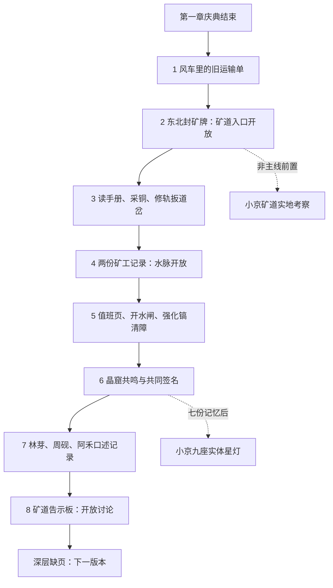

# 0.5.0《星辉矿脉》玩法与第二章

沿用原工程，原农场、小屋、河湾村保留，新增三张40×28、32px格的设计地图。角色使用原CharacterBody2D、相机、工具栏、体力、背包与AStarGrid2D。不是文字菜单或路线盘替代地图。

## 从正常流程进入

第一章风灯庆典完成后，在风车东侧读运输单，去村东北岩壁调查封矿牌，读完再选择进入。打开M手记的“矿道手记”可看当前任务、线索与位置。未结束第一章不能直接进入矿洞；不要求解锁小京。

| 地图 | 可以实际进行的内容 | 返回 |
|---|---|---|
| 废弃矿道 | 手册、铜铁矿、支架/工具/旧矿车、两份矿工记录、道岔、单格裂隙与隐藏工具箱 | 西南阶梯回河湾村，东北阶梯往水脉 |
| 地下水脉 | 持续地下河、石桥、上/下游阀门、铁锈岩层、值班页、铁晶矿、密封箱与小京副页 | 西南阶梯回矿道，东北深入晶窟 |
| 晶石洞窟 | 五处晶石、三处星辉原矿、三处钻石矿、三色晶柱、共同签名与星匣、小京副页及东南九座星灯 | 西南阶梯回水脉 |

地图有独立地表色板、岩壁碰撞、矿轨/支架/水流/晶体和无阴影玩家灯。仅当前图处理；没有无限随机矿层。

点击矿石自动走到合法位置、面对并用镐敲一次；再次点击再敲。工具栏手动选择及辅助开关仍有效。背包满时最后一击不扣体力、不破坏矿脉。点击记录/机关/宝箱/阶梯使用同一交互流程。原WASD、E与菜单切换备用摇杆继续工作。

## 矿物与升级

| 类型 | 地点 | 镐等级 | 耐久 | 每击体力 | 每处产量 | 刷新 |
|---|---|---:|---:|---:|---|---|
| 铜 | 废弃矿道 | 1 | 2 | 2 | 铜矿3 | 两日 |
| 铁 | 矿道/水脉 | 1 | 4 | 3 | 铁矿3 | 两日 |
| 晶 | 水脉/晶窟 | 2 | 3 | 3 | 晶石3 | 两日 |
| 星辉 | 晶窟深处 | 3 | 4 | 4 | 星辉原矿3 | 三日 |
| 钻石 | 晶窟深处 | 3 | 4 | 5 | 保底1，每第四处额外1 | 三日 |
| 裂隙岩块 | 隐藏通道 | 1 | 3 | 2 | 石4 | 不再生 |

镐高于矿物需求时每击伤害2，否则1；原农场工具架效果不另叠加到新矿石。矿物部分耐久、再生日和钻石计数保存。刷新避开玩家脚下；清除/再生会更新碰撞与导航。

周砚木作坊南侧新增矿物工台，修完第一段矿道后可建炉：石12、木8、120金。

| 升级 | 材料 | 金币 |
|---|---|---:|
| 普通→强化镐 | 铜锭3、铁矿2、木8 | 180 |
| 强化→星纹镐 | 铁锭4、星纹合金2、木12 | 450 |

| 加工一批 | 消耗 | 产出 | 要求 |
|---|---|---|---|
| 铜锭 | 铜矿4、木2 | 铜锭1 | 镐1 |
| 铁锭 | 铁矿4、木2 | 铁锭1 | 镐2 |
| 星纹合金 | 铁锭1、晶3、木2 | 合金1 | 镐2 |
| 星辉精炼 | 星辉原矿3、晶2、木2 | 钻石2 | 镐3、晶窟与共鸣门 |

加工次日完成，队列四笔，每笔按钮可选1或5批。入队先完整扣材料，领取只产出一次；满包或钻石上限时保留成品。队列跨地图/重启保存。

## 三种机关与隐藏通道

- 道岔：木6、石4、铜矿2修枕木；再扳手柄朝东打开路。错误方向可再扳，东西各有手柄。玩家站在道岔门内时不能合上碰撞。隐藏通道另有风声提示的裂隙矿块，清除后走进工具箱房间。
- 水位：看刻度，先上游进水阀，再下游泄水闸；反序回零、不扣材料。退水露出石桥，地下河仍在。强化镐再清理铁锈岩层，打开深层通道。
- 共鸣：采样刻痕给出麦穗/河沙/白石，按金→蓝→月白操作实际晶柱。错序复位，正确后开门，能走到共同签名和星匣。机关过程可中断保存。

没有必须随机猜测或不可恢复的错误状态。入口和上行阶梯不因错误锁闭。

## 第二章《山谷深处的回声》

主线发现：停矿并非资源枯竭，洪水时有人改订单、有人守闸、有人用空车接人。三位原NPC分别保留农业、父辈、居民记录的视角，没有突然出现的反派。八项任务各有事实、前置、进度、奖励和不可重复标记。

第一章农业贸易/自然探索/居民生活影响本章对白与讨论会奖励（铜矿6/晶3/小麦6）；三个方向都能探索全部矿区。讨论会可选公开轮换、保留用水农产、先测深层；本版保存该选择，后续政策效果尚未实现。终章后半与完整星辉深渊留后续。

小京旧七记忆保留，水脉与晶窟各有同ID补页，不重复计数。新矿道试炼要求同日20格、四矿、水脉与回程、余体力20、采矿消耗≤90。星灯试炼在晶窟东南实际行走操作；五步全亮有解。她不是第二章解锁条件。
