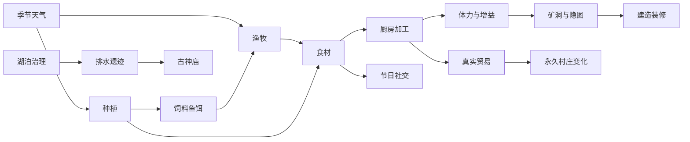

# 《像素世界》0.7.0《四季万象》实际开发报告

本版直接在现有Godot4.3工程整合完成，未重建项目。实际起点为0.6.2、存档v11、Git5f2daef下的大量未提交开发；先建立恢复快照与3968f07提交，再在development/0.7.0按A–E阶段开发。原玩法和玩家数据保留，测试不触及真实用户存档。

## 实际完成的系统

| 系统 | 可玩内容 |
|---|---|
| 四季天气 | 每季28日、每年112日，年份/季内日由绝对日派生；九天气、预报、独立满月夜、四套地表/树木与雨雪雾/流星效果；雨灌、雪不灌、冬季部分原作物停长保留。 |
| 自由钓鱼 | 原湖/村河/地下水脉和两个隐图岸点，点水自动靠岸、抛竿等候、触屏/空格追鱼小游戏；三级竿、饵、耐久钩、等级、图鉴/成就、季节/天气/夜鱼与永恒星鲤。 |
| 湖泊 | 原四栏/六鱼/三级设施沿用；全湖生态、种草、清淤、循环设施、可恢复的密度影响、真实成长与稀有权重联动。 |
| 畜牧 | 鸡舍/牛棚/羊圈、三级2/4/6容量，最多18只可见动物；独立成长/饥饿/心情/亲密/位置/产物，喂食/抚摸/放牧/有成本繁育；雨雪/冬季真实返回可见暖舍。 |
| 厨房加工 | 小屋实体厨房、五新料理与旧鱼料理同额度；磨坊/奶酪/熏鱼/果酱四设备，四笔跨日队列和唯一领取；移速、节能、采矿与钓鱼单一限时增益。 |
| 节日夜生活 | 四季24日实操春播/夏钓灯会/秋展篮/冬送餐，现场NPC与限购商店、年度唯一奖励；春铃花种可在实体庭院花坛栽培三日并采收，特殊月夜可现场记录唯一月影笺。 |
| 社交 | 四人年度生日、喜恶、每日/季节/天气/节日对白、日限与重复礼物反馈；三村民各三个人事件，小京三章承载六项新活动；错过约定可实操修复，旧婚姻前置不加锁。 |
| 家园 | 基础/扩建/高级三阶段，真实新增20/63格侧间；十类室内/四类庭院家具，网格预览确认/移动/回收/墙纸地板/已婚专属桌，真实2/4/8种储物，保护原床门厨房故事通路。 |
| 隐藏探索 | 迷雾森林、封闭干燥湖底排水廊、古老神庙，均为40×28实体地图；分岔/符桩/水闸/校镜/多步谜题、档案、唯一箱、可再生材料、手作与四季收藏，出口可达。 |
| 永久世界 | 原桥/公共设施/风灯/温室保留；新两级陆岸码头/交易棚与两级社区灯/花坛/雨棚，真实新产订单/巡灯/每周原NPC共餐，随四季叠加并保存。 |
| 兼容与操作 | 保存v21兼容v1–v20，旧金币/作物/矿洞/关系/钻石/婚姻/操作方式保留；默认点击与备用摇杆、桌面键鼠、模态/多指/切图/后台取消与防重复结算。 |

原三地图、第一章《河水带走的名字》、第二章16任务、百层深渊及所有原NPC继续保留。小京原520成功农田播种、三属性100、12专属任务、7记忆、5试炼、温室与1314钻石婚礼及婚后520日不重置、不被新支线替代。新增三隐图不把小京作为强制前置。

## 用户追加问题的实际修复

源码首导入也已核验：数据类间接引用字体/贴图/音频导致缓存尚未生成时提前预加载，现使用同资源的运行时加载，空缓存--import与独立运行验证，源包不依赖本机.godot缓存。

浇水人物偏移根因为精灵每帧只重置y、水平动作偏移不断累加；动作中原移动输入仍生效。现完整重置精灵位置，水壶不做身体位移，0.24秒固定脚底/朝向，后续目标替换后等待动作结束。触点按下时捕获世界坐标，避免相机跟随期间释放到另一格；原多指/UI/模式切换保护保留。

白天可在屋东休息椅每日三次、各20游戏分钟恢复15体力；基础零食三份恢复8/12/4，原茶座40与每日一餐料理继续可用。满体力不耗机会/物品，椅子不跳日、不刷作物/鱼/矿。原20点睡眠、午夜60%恢复与唯一日结算不改。体力不足提示直接引导椅子和食物。

其他实际修正：屋内旧任务卡遮住侧间家具触点；扩建门洞新旧保存范围有缝；社区站点非格心/默认与活动站点反复设置导致NPC不停重规划；未解锁小京却带个人/夏日事件标记的跨分区矛盾。均有回归，不用放宽测试或删除功能规避。

## 内容入口与循环

新内容均可在正常流程到达：鱼竿第9格；原湖岸鱼栏/水样台；农场南三畜舍；小屋东厨房/西装修台、屋西莓丛与庭院台；NPC原对话中的近况入口；每季24日活动牌；西北林门→生态修复后的湖东检修阶→两份档案和高级矿业后的村东神庙；村庄共建发展牌。

详细新个人任务表见[阶段C报告](REPORT-0.7.0-C.md)，隐图与发展流程见[阶段D报告](REPORT-0.7.0-D.md)，操作与数值见[玩法速查](GUIDE-0.7.0.md)。

## 验证结果

完整自动入口实际执行**2964项、0失败**；原各系统及所有新增套件共同通过，独立进程持久化/备份另行验证。10套真实桌面窗口矩阵**356项、0失败**，包含原生触点、三横屏比例、真实抛竿追鱼、动物/家具/节日/隐图/施工/花/月影操作。

原320次生命周期检查继续过；新增预热后240次含新地图切换，节点1044→1044、Godot静态内存变化−13,424字节。切图调用P50/P95约0.71/0.89ms、导航重建约3.40/4.58ms，属于Linux无头CPU样本，不含完整异步呈现、Android GPU或长时RSS。无对象泄漏错误。

实际运行10,000组×28日经营模型及配方/贸易审计。农田/钓鱼/六畜/加工增量每日净金P50约164.79/112.29/120.00/23.71；它们是独立渠道，不能直接相加。新增正数钻石奖励配置0，料理无高价原料放大；这不是真人实际完成时长。[完整经济报告](ECONOMY-0.7.0.md)。

[测试证据](VALIDATION.md)以builds/check-0.7.0-acceptance.log、window-0.7.0-acceptance.log为最终依据，中间失败与夹具修复记录保留。

## 源码、构建与Git

完整工程在当前工作区，另提供PixelWorld-0.7.0-source.zip，含素材/数据/全部源码/测试/文档/生成工具，不含引擎缓存、签名和玩家存档。

Android Debug为PixelWorld-0.7.0-debug.apk，包名org.pixelfarm.windbud、原证书与用户目录不变，code11。实际导出/清单/签名/对齐/CRC/数据/许可及最终APK资源脱离源码启动通过；实际覆盖安装尚未执行。文件大小和SHA256以[ANDROID.md](ANDROID.md)及制品旁校验文件为准。

主要新模块分布于scripts/seasons、fishing、ecology、livestock、kitchen、festivals、social、housing、exploration、world_progress、recovery。原main只协调，核心操作仍经原Inventory与状态层；全物品由Catalog集中注册，各原ID不另造冲突副本。地图、像素和音乐均沿用原创体系，新增生成器可重复产出美术。[素材来源](ASSET_PROVENANCE.md)。

阶段提交：基线3968f07、A8fff842、B0b33ab6、C5699536、D7989209；E最终版本提交在development/0.7.0末端。原Git历史与既有未提交内容保留，未推送或重写用户历史。

## 尚未验收与后续

没有连接Android真机，未实测安装/覆盖、触摸手感、后台系统回收、低端帧率、温升、电量或20–60分钟负载；也没有Windows/macOS实机和真人从新档完整多季经济校准。桌面/模型/制品启动不能替代这些项目。

秋评比以真实本季新产与组合评分，尚无银/金星物品分堆；装修为安全区网格操作，非任意位置自由拖旋；暖舍为可见剖面场景，非另一个可进入室内地图。首版款式与内容量有扩展空间。[完整边界](KNOWN-ISSUES-0.7.0.md)。建议下一轮优先真机与长期试玩，再依据反馈加深品质、纺织、温室种植或装修操作，避免只靠等待/掉率拉长时间。
