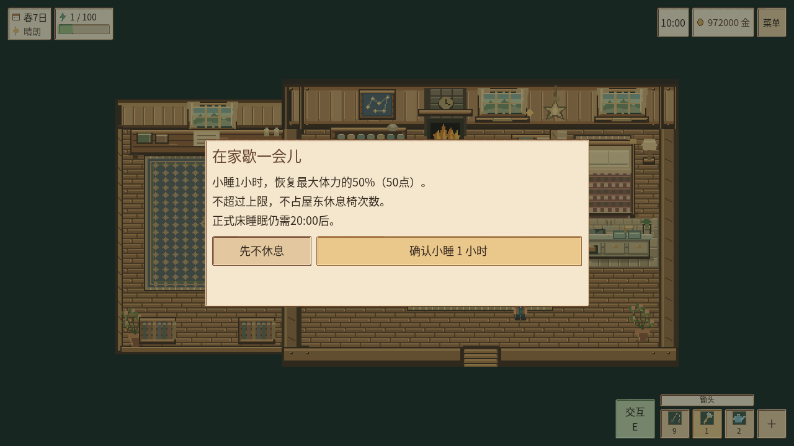

# 住宅05：四阶段住宅、沙发小睡与家内UI

版本0.7.1《匠心打磨》，Godot4.3；开发起点`6c904f0`，建立恢复分支`safety/home05-start-6c904f0`。用户原有未跟踪`need/`参考图未修改、未提交，也不打进APK或源码交付包。本轮围绕住宅实施，不更改种田、矿洞关卡/掉落、湖泊、畜牧、主线、小京婚礼或全局经济。

## 四级住宅实际内容


| 等级 | 名称 | 实际空间与外观 |
|---|---|---|
| 1 | 温馨小屋 | 卧床、沙发、厨房灶台/水槽、用餐桌椅、收纳柜、木盒书桌、壁炉、窗户、织毯与植物；保留可装修空地 |
| 2 | 舒适农舍 | 新增相连侧间、独立小工作/生活区、花窗和软垫细节，更多布置及收纳空间 |
| 3 | 河湾大屋 | 扩大侧间书房、书架、大织毯、卧室屏风门框、壁炉钟、高级木板与床被；保留全部基础功能 |
| 4 | 星光庄园 | 更宽侧厅、长书桌与双书柜、庄园拼接木地板、蓝绿星纹沙发、浅石台黄铜厨房、观景窗、星图与星灯；大块地面留给自由装修 |

[一级原图](home05/level_1.png) · [二级](home05/level_2.png) · [三级](home05/level_3.png) · [四级](home05/level_4.png) · [20:9四级](home05/level_4_wide.png) · [旧屋与新版对照](home05/compare-interior.png)。

51张原创PNG由[像素资源生成器](../tools/generate_home_interior_assets.py)生成，细木纹、玻璃窗帘、器皿、织物、火焰、书架和投影分层绘制，采用最近邻；没有复制参考图像素或将整张图用作背景。用户三张图用于住宅氛围和空间组织研究。旧自选墙纸、地板优先于等级默认内饰。

室内仍是实际TileMap、实体家具和原玩家，并非整张房间图片冒充地图。`HomeLayout`统一各等级地图边界、扩建区域和固定碰撞；原门、床、厨房、信件、储物与婚后人物站位保持。储柜、书柜的落地基座阻挡，顶视投影可按正确前后层次遮挡角色。所有必需交互位置可寻路。

屋外只更新原玩家房屋同尺寸贴图；保留192×168透明轮廓、原碰撞与入口，不移动其他农场建筑或农田。施工完工时内外同步显示同一等级。

## 建造费用与流程

| 升级 | 木材 | 石头 | 其他现有材料 | 金币 | 工期 |
|---|---:|---:|---|---:|---|
| 1→2 | 30 | 20 | — | 2500 | 2游戏日 |
| 2→3 | 60 | 40 | 铁锭12 | 7500 | 2游戏日 |
| 3→4 | 100 | 70 | 星辉残晶20 | 18000 | 2游戏日 |

星辉残晶使用既有`star_fragment`，可从原81–100层高级矿脉正常获得；没有新建重复“高级晶石”物品、改变掉率或绕过原工具/护具条件。住宅升级严格使用金币及材料，不借用其他交易的钻石付款状态。

在周砚/矿物工台的既有服务中选择“住宅改建”，可看当前等级、下一阶段、材料持有量、空间示意和工期。家内装修台也可查看图纸，受理需到周砚附近。点击受理先确认；确认后一次扣款，生成唯一工单。第一个夜晚后仍施工，第二次正常跨日后完工。施工期间保持原房型，床、厨房、沙发和保存均可用。

[升级预览](home05/upgrade_3.png)是明确标注的布局示意，非伪造的房间截图。取消不收费，重复请求和重复日信号不再次收费或发奖励。

## 家具与旧进度

原房屋系统扩展为四级，未另建第二套。原1/2/3级按实际状态保留为同级新名称，不降级、不补收费；农场卧室升级的体力上限仍按原规则，房屋升级不重新发放体力加成。

迁移/完工协调家具时先保留安全原位，再按距离寻找安全空位，保留原ID；无位保留完整原记录到恢复收纳。取回只恢复一件家具，满家具库存时保留暂存，不复制原材料或储物。手动摆放复用同一保护范围，避免堵住床、门、厨房、沙发和储物位置。正常旧合法区域与新固定家具避开；注入冲突与满区测试验证了移动、暂存、取回及重复调用守恒。

储物种类沿用原2/4/8，四级为16；**背包容量、999堆叠和物品经济未改**。

## 沙发小睡



- 可在任意游戏时段使用，没有新增每日次数限制。
- 普通一次推进60游戏分钟，恢复`ceil(当前最大体力×0.5)`，不超过上限。100上限恢复50，原卧室升级后的130上限恢复65。
- 体力已满仍可选择推进时间，确认框明确提示不额外恢复；不占屋东休息椅次数，不消耗食物或金币。
- 每次确认绑定唯一token，先使其失效，再同步提交完整时间/体力；0.3秒淡出仅表现结果，不留待发奖励。过渡中菜单/重复确认不能再提交，关闭、换图、切模式、后台和加载清理旧确认。
- **23:30开始时只推进到24:00**，立即进入原`GameClock`疲劳结算：仅跨一天、06:00醒来、原60%体力优先；不补余下30分钟，不再叠加沙发50%恢复。普通白天小睡不发次日信号。
- 正式床仍20:00后才可使用，24:00自动昏睡及原时间比例不变。核心时钟脚本未修改。

[沙发演示GIF](home05/sofa-demo.gif)由确认/真实过渡/结束三个Godot窗口帧组合，非Android录屏或帧率测量。[结束原图](home05/sofa_after.png)。

## 厨房与家内UI

检查发现原厨房本就位于小屋，保留唯一`KitchenWorld`入口和`Kitchen.ANCHOR`，本轮将其融入完整厨房家具区，移除旧独立柜台重复绘制/碰撞。所有等级仍调用原`Kitchen`配方、材料、料理、加工队列和增益事务。

家内厨房采用左侧食谱选择、右侧材料/成品/操作，查看不制作；确认制作仍用原流程。正式床、沙发使用统一较小确认窗；床整张图像与沙发可准确点击，自动走到合法邻位。没有重新设计全局点击移动。家里不常驻泛用大提示，只在靠近具体交互物时显示简短提示。

[厨房UI前后](home05/compare-kitchen.png) · [床确认UI前后](home05/compare-bed-ui.png) · [厨房实际界面](home05/kitchen.png)。

## 验证

开发前六套相关基线：385项断言零失败；另捕获10张旧版室内/厨房/床确认真实窗口图。最终[机器记录](TEST-HOME05.json)：

| 验证 | 实际结果 |
|---|---|
| 完整自动化 | **3926项，0失败** |
| 完整真实窗口 | **2375项，0失败**，24套 |
| 计划进程 | **120/120全部通过** |
| 新住宅状态专项 | 102项，含真实三次两日施工、三阶段施工中进屋/小睡/厨房实操、内外等级、取消/费用/重入、家具、v22逐字段迁移、130体力、午夜优先 |
| 新住宅窗口 | 44项；实际原生确认施工、四级实际房型、沙发/厨房/整床点击、20:00限制、UI触区及安全区 |
| 新独立持久化 | 7进程、22项断言，含施工中写入、次日完工、重复恢复、坏档备份、已提交小睡过渡后重启 |
| 真实异常退出 | 原半写时SIGKILL、独立重启恢复通过 |
| 原系统回归 | 农场/矿洞/湖泊/畜牧/剧情/小京婚礼/睡眠/移动/背包原套件通过；全模态与64/96逻辑触区矩阵通过 |

本轮实际失败及处理记录：

1. 旧两个移动夹具把床中心当作无交互障碍，新需求使整床可点击；改用实际阻挡的无交互柜体`(464,272)`，保留有限失败、清零和交互次数断言。单项452/53及最终全套通过，没有修改导航标准。
2. 初步路径探针只识别旧`kind`，漏掉沙发/床的新节点；补充真实节点识别，同时新床保留兼容`kind`属性，不削弱路径断言。
3. 美术生成与初探并行时曾读到未导入PNG，这些带资源错误的中间日志未计通过；冻结后集中导入并全套重跑，最终无资源/脚本/泄漏错误。
4. 初次截图处在转场和通知内，重新在稳定帧捕获，不用暗色过渡帧冒充最终室内。14张最终实际帧、四级拼图、三组前后对照和小睡演示均在[截图清单](home05/screenshots.json)。

额外只读物理探针28项、纯几何探针14项均通过，单独记载，不重复加进全套3926。

## 存档与构建

当前schema **v23**。v22→v23只扩展`housing`的施工、唯一记录、结算日期和恢复收纳；迁移深复制输入，原钱、背包、农作物、矿层、婚姻、钻石、操作模式、厨房和家具保留。沙发token/动画不持久化，没有离线补发小睡。保留原临时文件/备份/更名流程与存档路径。[迁移记录](SAVE-MIGRATION.md)。

Android调试APK：`builds/PixelWorld-0.7.1-debug.apk`，**68,125,714字节**，versionCode **14**；原包名`org.pixelfarm.windbud`、证书及ARM64/ARMv7保持。SHA256：`c70499da764b2eeadbbd824d274e5d430ea5e6069ddd47c31f71f41420e89308`。

签名/清单/对齐/CRC/数据许可通过；提取APK实际资源在隔离桌面Godot运行180帧，v23、厨房和住宅资源/相机/工具栏接口检查通过。**ADB没有设备，Android真机视觉、手感、覆盖升级及手机性能均未验收。**

## 修改范围与提交

- 住宅：`scripts/world/home.gd`、`scripts/housing/`相关状态、布局、外观、休息、预览及家具UI，`resources/housing/housing.json`。
- 家内接入：`main.gd`、HUD、厨房面板/交互点、目标识别；相机/导航只调整home分支边界。
- 周砚服务：现有服务菜单仅增加住宅入口，不改矿洞玩法或NPC剧情。
- 存档：schema/store局部v23迁移、施工半事务写保护及过期工单恢复。
- 资源：`assets/housing/interior/`51张原创PNG及生成器；原全局主题继续复用。
- 测试/交付：HOME05三套新场景、相关旧夹具与矩阵、构建/包内验证、截图整理和文档。

本轮独立提交：`feat: improve farmhouse interior and add sofa nap`，具体编号见本报告所在提交的`git log -1`。原`need/`未跟踪参考目录保留。

没有发现待修复的桌面阻断问题。未进行长期人工游玩或Android真机验收；这是剩余验收边界。任务到此停止，不开始下一项。

```bash
python3 tools/check_project.py
python3 tools/check_windows.py
python3 tools/check_interrupt_071.py
python3 tools/generate_home_interior_assets.py
python3 tools/capture_home05_artifacts.py
python3 tools/summarize_home05.py
python3 tools/build_android.py
python3 tools/verify_apk_runtime.py
python3 tools/package_source.py
python3 tools/verify_source_package.py
```
