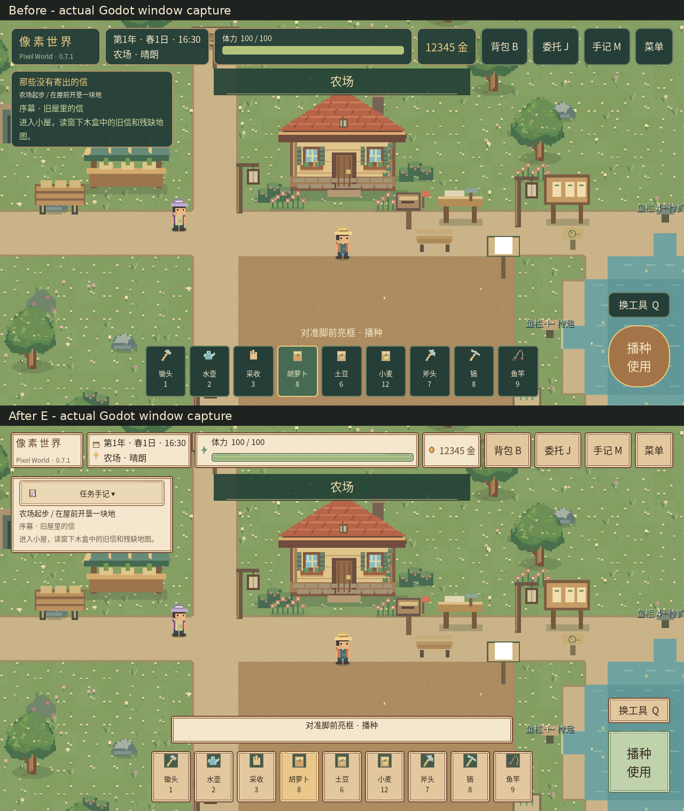
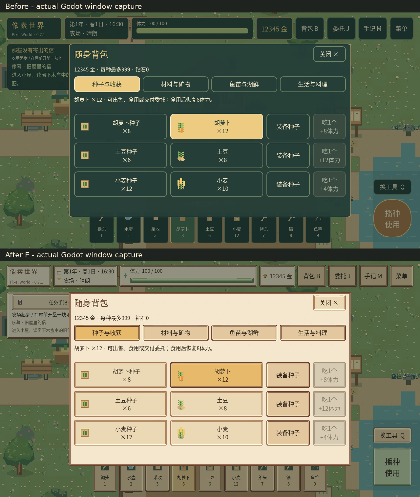
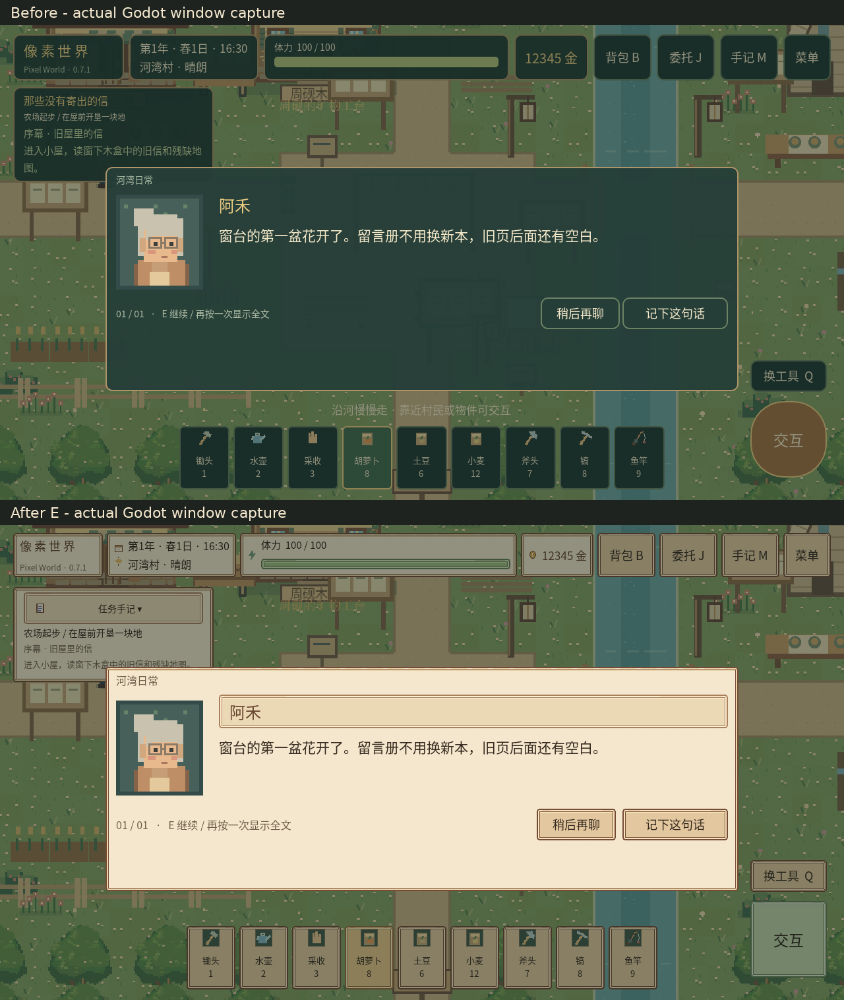

# 0.7.1全局UI视觉重设计实际报告

从已验证背包优化03的e51b293继续，完整Godot4.3工程增量修改，原未提交工作得到保护。风格为「河湾手作 · 星辉田园」，UI以原创木框/羊皮纸/深色中文统一，小京页面使用少量星辉紫。A–D已独立提交，E完成综合验证与交付。

## 完成内容

- 原创可拉伸九宫格13角色、5状态图标，共18张UI图；公共Theme/语义色/字体层级与可复现生成器。
- 紧凑HUD、可折叠任务卡、清晰九工具、纸色通知与地图提示；任务状态/日期季节天气/金币体力均保留。
- 背包/商店选中、数量、物品图/详情沿用03逻辑，统一卡片和页签；食物仍可按已授权规则持续恢复体力。
- NPC对话姓名牌/头像/正文/选项、主支线/人物关系、图鉴与收藏统一层次，正文和回调未改。
- 厨房、鱼栏、畜牧、建设/农场升级、矿道/加工、生态、家具、节日等全部已有面板共用主题。继承的特殊面板自动统一，避免复制新实现。
- 钓鱼追鱼、矿洞/试炼、婚礼/婚后界面统一纸底/可读文字与适度星色。危险确认仍用原条件/资源结算，支付标题栏透明导致文字重叠已修复。
- 原有保存/读取/静音/操作方式/辅助/指南/继续菜单统一；两种操作模式和原保存设置保持。

## 截图

优化前后都由实际Godot窗口截取，没有把静态设计稿冒充可交互界面。八个代表页面具有同流程before/after-E图，主要三组对照如下。

更多实际画面：[小京关系](ui04/xiaojing-relationship.png)、[厨房](ui04/kitchen.png)、[高密度商店](ui04/shop-target96.png)、[安全区对话](ui04/dialogue-safe.png)。

## 验证结果

**3402项自动化、1899项窗口检查，零失败**。其中原窗口1049项、新全局矩阵850项；完整v22旧档迁移/独立重启/坏主档备份恢复、移动/农活/背包/料理/520/1314条件与百层关卡原检查继续通过。

横屏实际窗口覆盖16:9(1280×720)、19.5:9(1560×720)、20:9(1600×720)、4:3平板(1280×960)、左右64安全区。密度注入320DPI→64逻辑像素、480DPI→96逻辑像素，检查最小目标、滚动可达、中文边界、全部既有模态面板、原生触点及地图不穿透。没有把逻辑48px等同物理48dp。

密度首轮175项中5失败，分别为委托/建设固定堆叠溢出及长按控件不足。现仅UI层滚动化进度面板并扩长按区，175项复跑全过。旧样式测试因StyleBoxFlat类型写死出现过错误，已改为真实九宫格材质的选中状态验证，原命中/数量标准不改。编译缓存未注册和中途读取半写文件的失败进程均停止重跑，不当通过。日志和分项见[UI04-TEST.json](UI04-TEST.json)。

## 兼容与范围

存档仍v22，未改结构、路径、包名/证书。全局UI业务接口、文本内容、资源ID/费用/价格/成长、三属性/520/1314、天气/睡眠/速度/寻路算法不改。新增UI状态（折叠、密度provider、样式）不写存档。DiamondPayments文件只有显示/触区相关差异，支付回调与计算保留。

主要改动为FarmUIStyle、Theme/纹理、HUD、背包、对话、任务/关系面板、已有经营/探索面板的颜色与滚动、两个钓鱼绘制控件、设置及支付窗口局部样式；增加UIMetrics和窗口矩阵。全量文件清单可用git diff e51b293 --stat审查。

A f3a2404：公共主题；B 9db93fb：日常UI；C 0055fe7：经营探索；D d820cee：特殊/设置/支付。E为最终验收提交，编号见交付时git log。

## 构建与未验收

已导出PixelWorld-0.7.1-debug.apk，包名org.pixelfarm.windbud、原证书、双ARM ABI、code12保留，清单/对齐/CRC/数据/许可验证通过。最终APK包内资源独立桌面启动180帧，v22/纹理主题/96触区换算接口检查通过。[Android详情](ANDROID.md)。

实际ADB无设备；安装、覆盖升级、物理触区/中文观感、手机手感、系统原生窗口装饰及低端性能未真机验收。测试中的密度样本是桌面注入，不冒称Android硬件结果。右上原生支付小关闭图标仍受引擎装饰控制，主要取消按钮按目标扩大，手机该区域仍需核验。

原工程没有独立标题场景/新游戏按钮/退出确认或音量滑杆，本次未新增这些业务功能；当前游戏内菜单已有功能已统一。本轮不是这些不存在功能的完成声明。所给参考网页均超时，未声称查看；全部新增素材原创，见[设计规范](UI04-DESIGN.md)与素材溯源。完成后停止，不自动开始新玩法或其他优化任务。
