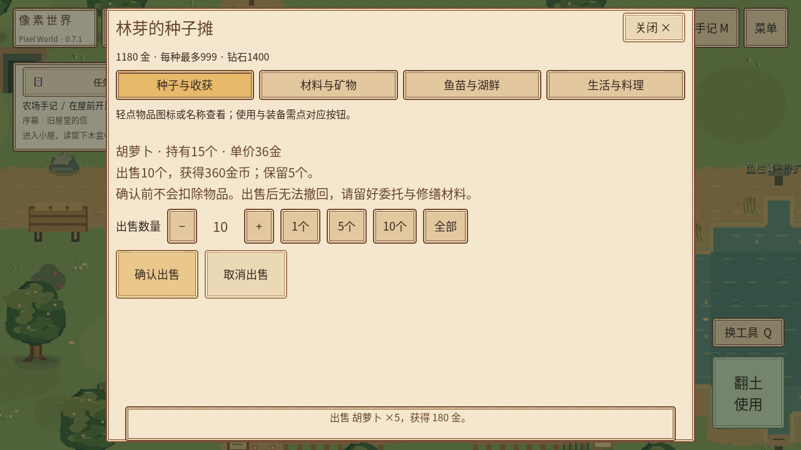

# 按数量出售

原商店只把当前物品的全部库存传给出售确认，底部“每次购买”的加减按钮仅控制购买。经济事务本来支持指定出售数量，本轮只补齐界面和确认状态，不改售价、金币收益、物品ID、堆叠上限或存档结构。

## 使用方式

在林芽的种子摊选择物品分类，点击该物品的“按数量出售”。默认出售1个，可用“−／＋”选择任意持有数量，也可点“1个／5个／10个／全部”。确认页同时列出持有量、单价、出售数量、总价及出售后保留数量；点击“确认出售”才成交。“取消出售”保留全部资源。

作物、材料与矿物、可出售鱼类及生活物品都复用这个入口。原“出售全部”按钮保留，也会先进入确认页，仍可调整数量。购买数量与出售数量独立，出售确认期间隐藏无关购买控件。

## 安全规则

- 数量限制为1至当前实际持有量，不超过原999堆叠上限。
- 改数量会更新确认编号，旧按钮或迟到回调不能确认新数量。
- 确认期间增加库存不会自动多卖；库存减少到不足时禁用确认，并提示重新选择。
- 取消、关闭、切换分类、场景切换和读档不会留下可继续执行的旧出售；重复确认只结算一次。
- 实际扣物和金币结算继续由原`FarmEconomy.sell`及`Inventory.exchange`原子校验，失败保留资源。
- 数量预览及确认状态不写入存档，已有物品和金币照原流程保存恢复。

## 实际验证

所有检查在临时用户目录执行，不操作玩家存档。

| 检查 | 实际结果 |
|---|---|
| 开发前背包与Palm状态基线 | 51＋28项，0失败 |
| 新增数量出售状态 | 35项，0失败 |
| 新增原生触控窗口 | 24项，0失败 |
| 原背包与Palm状态回归 | 51＋28项，0失败 |
| 原Palm与背包窗口回归 | 296＋136项，0失败 |

窗口使用真实Linux Godot4.3 Xvfb/Mesa，覆盖1280×720、1600×720及1280×960；验证按钮命中、数量切换、单次结算、安全区域和UI不穿透。最终日志无脚本错误、FAIL或实例泄漏。首次自写窗口夹具把非滚动区按钮传给`ensure_control_visible`，已改为先检查祖先关系；有ERROR的中间运行不计通过。

没有Android真机，手机DPI、实际触感和覆盖安装仍待验收。

## 文件与复现

生产修改：`scripts/ui/inventory_panel.gd`。新增状态及窗口测试：`tests/sale_quantity_runner.gd/.tscn`、`tests/sale_quantity_render.gd/.tscn`。

新增状态入口为`res://tests/sale_quantity_runner.tscn`；新增窗口入口为`res://tests/sale_quantity_render.tscn`，后者直接运行，不需要额外参数。状态入口也支持`-- --window`切换为窗口检查。测试应使用临时`XDG_DATA_HOME/APPDATA`，窗口需可用DISPLAY或Xvfb。

实际日志：`builds/sale-quantity-state.log`、`builds/sale-window-sale_quantity_render.log`、`builds/sale-regression-inventory03_runner.log`、`builds/sale-regression-palm_runner.log`、`builds/sale-window-palm_ui_render.log`、`builds/sale-window-inventory03_render.log`。
