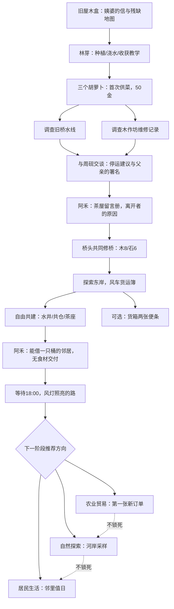

# 0.4.0 剧情设计：那些没有寄出的信

第一章《河水带走的名字》。核心冲突不是外来的敌人，而是停运、断桥和居民离开之后，留下的人如何重新承担共同生活。

林芽保留尚未兑现的农业订单，希望恢复贸易，也怕路通之后年轻人继续走。周砚父亲周衡在桥垮以前叫停重车、护送居民；周砚不愿把修桥变成单纯的自证。阿禾保存的不是欠账，而是送饭、借桶、护送的回执；她希望村民重新愿意开口求助。

用短对白、桥墩两条水线、维修盒、留言册、货运簿与两张未寄便条，让玩家拼出离开的原因。没有隐藏反派，没有把离村居民写成背叛者。

## 第一章流程

## 数据与事务

`resources/story/letter_quests.json` 定义任务ID、标题、描述、类型、解锁条件、完成条件、当前进度计算方式、奖励、后续与重复性；运行进度由 `Letters.progress()` 计算，完成列表保存在存档。支持采集、种植、交付、调查、交谈、时间条件、建设、选择、区域探索与多条件。原有河谷交付委托保持独立。

原有 `Story.stage` 0–8 继续作为已经提交的章节事务，不重新编号。调查事实保存于 `letters.facts`；提交前再次检查前置。对话取消或显字不提交。原有50/120金由原剧情事务发放，任务定义用 `settled_by` 声明归属，避免重复奖励。第二章三个起步任务有独立的一次性奖励：贸易30金、探索小麦种子3、生活25金。

三种终幕选择各给一份种子：贸易胡萝卜3，探索小麦6，生活土豆3。方向保存在 `letters.direction`，只影响推荐顺序、对白、种子奖励；其他任务保持开放。旧通关档通过 `future` 补充事件领取一次方向奖励，不重新领取庆典120金。

## 世界表现

- 林芽白天农场摊位，18:00后村中广场/已建茶座；手记提示时段，避免找不到任务NPC。
- 周砚修桥期间在西桥头，通桥后14:00–18:00可到东桥头；平常木作坊。
- 阿禾12:00–14:00到已建水井洗杯，晚间到已建茶座。
- 首章风灯阶段18:00后三位在广场相聚；通关后晚间改在已建茶座相聚，风灯装饰持久保留。
- 站点间四向网格路线采样当前真实脚底碰撞，NPC用CharacterBody2D移动；模态时停止，阻塞重试有限。
- 存档不保存过期路线；恢复日期、建设、章节和安全站点后重建日程。

范围限制：只有少量稳定站点，无跨地图可见长途旅行、完整生活模拟和第二章长篇主线。三图与已有美术继续复用。
