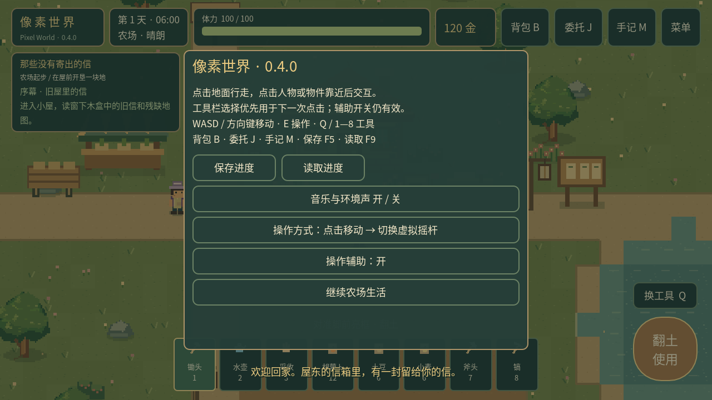

# 点击移动与备用摇杆

Android和桌面默认使用点击模式。点击地面自动走到该32px格的可达格心；点击新位置替换旧目标。电脑仍支持WASD、方向键、E和鼠标左键，键盘移动立即打断自动行走。

## 两种模式自由切换

右上「菜单」→「操作方式」按钮，在「点击移动」和「虚拟摇杆」之间随时切换。切换立即释放摇杆、取消路径、待执行交互与未完成手势，模式自动保存，重启恢复。v1–v5旧存档默认点击模式。

## 点选与执行

| 点击目标 | 到达后的单次动作 |
|---|---|
| 地面 | 沿可通行路线到格心停止 |
| 村民/小京 | 靠近、面对人物、打开原对话/关系面板 |
| 未翻土地 | 锄头翻土 |
| 空的已翻土地 | 使用当前选中的种子；没有选种子则提示 |
| 已种缺水作物 | 水壶浇水 |
| 成熟作物 | 收获入包 |
| 树木/石堆 | 自动选择斧头/镐，采集一下；再次点击再采集 |
| 房门/路牌 | 靠近入口后切换原地图 |
| 商店、修缮台、委托板、共建板 | 打开原界面 |
| 水井、长椅、信箱、调查点、记忆 | 调用原剧情交互，保留前置、每日限额与费用 |

工具栏的主动选择优先用于**下一次**农田/资源点击操作，尝试后恢复状态判断。工具栏当前选中的种子用于空田播种。菜单的「操作辅助」关闭后，农田和采集均只使用当前工具，不自动切换。选工具会取消正在执行的旧点击；这不会修改或扣除农田、物品。

智能系统只负责找目标与到达；原种田、采集、库存、剧情系统继续核验体力、种子、背包容量、作物状态、材料及任务前置。行走期间不预扣资源，同一次点击不会反复触发动作。失败播种仍不增加小京计数。

## 取消、失败与界面

- 对话、商店、背包、手记、菜单开启，地图切换及应用后台，立即停止并清空旧意图。
- UI按下归属一直保留到释放；关闭界面后的旧触点释放不能穿透地图。
- 地图只接受单指短点；拖动、取消、同时多指不会变成移动，UI按钮与滚动仍独立处理触点。
- 不可达点给出轻量提示并停止；动态NPC换位可重规划，卡住有有限重试与总时限。
- 不保存运行路线或目标节点；读取存档后从静止状态按当前地图重新规划。

## 实现与边界

TouchInputManager → InteractionResolver → WorldNavigation → AutoMoveController → InteractionExecutor。状态为IDLE→PATHFINDING→MOVING→IN_RANGE→INTERACTING→IDLE，取消/失败清空路径。

寻路使用Godot4.3的AStarGrid2D，32×32基数网格。静态网格以20px脚底方框留安全余量；相邻格之间也检查完整扫过的空间，防止跨越格边的薄围栏。AStar的碰撞边采用高代价并在结果中严格拒绝，合法路径始终优先。非格心旧位置通过真实圆形脚底扫掠寻找合法起点，不强行把障碍格清空。动态NPC单独叠加占位；交互末端还检查距离与视线，不允许隔墙交互。

农场、小屋、河湾村分别构建网格。静态碰撞按变更缓存，桥梁、树石清除/再生、地图切换、读档触发失效，并等待物理服务器同步后重建。正常点击和跟踪NPC不重复扫描整张静态地图。修正了原阿禾茶屋站点与桌子重叠的问题，场景、商店、资源和剧情规则继续复用。

现阶段提供短点与目标标记，不加入长按追踪或复杂手势。**桌面原生触点、真实物理帧及窗口渲染验证不等于Android真机验收**；手机触感、硬件兼容、多指系统行为、安全区、后台与覆盖更新仍待目标设备测试。
