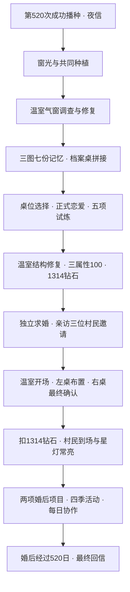

# 《第 1314 颗星星》：小京支线深化说明

当前版本为0.6.0《星河之约》；本文件保留既有阶段/任务设计，新增100层、第二章完整与独立婚礼以[当前报告](REPORT-0.6.0.md)为准。
工程仍为0.5.0，存档升级v9。本次在已验证的三张实体矿洞、原有农场/第一章/第二章/点击与摇杆系统上增量开发。没有新建项目，没有重置旧任务、三属性、记忆、试炼、钻石或婚姻。

上一轮六幕深化开始时534项检查通过；修改前工作区快照为`/tmp/PixelWorld-before-star1314-20261023.tgz`。包名、签名配置和用户存档目录未改；本次不打包APK。

## 复用与新增

| 复用系统 | 本次扩展 |
|---|---|
| 农田成功提交、体力、库存原子交易 | 新试炼合约、季节活动、付费货币预览 |
| 小京现有任务ID与结算、三属性、婚姻账户 | 六幕、剧情门槛、选择、预约/修复、婚礼现场阶段 |
| 三张原图与三个真实矿区 | 温室档案桌、两张研究桌、种箱、矿洞重访观察 |
| 原输入解析、执行器、模态与NPC网格 | 所有新点复用点击靠近/E键；婚后分时日程 |
| 临时写入/备份/完整校验 | v8独立star_story字段、旧进度映射、跨进程恢复 |

## 当前传说升级

新增深渊前20层、三份原件最终推理、五阶段温室和五强化徽记。目标提高到200–350小时，当前模型与真人验收均未达到。新婚约需完成新增目标；已求婚/已婚旧档保留已确认的承诺。完整现行准入、资源费用和分阶段范围见[LEGEND-ENDGAME.md](LEGEND-ENDGAME.md)。以下保留六幕与12任务的基础清单，强化版可直接认可同类原试炼，不需重复做十场。

## 六幕剧情

1. **第 520 次播种**：那封信没有邮戳。小京认出你留在田里的脚印，却先问起哪一垄最怕积水。
2. **荒废的温室**：封住的气窗旁有一枚铜铰链。她回来寻找的，是当年为什么没人再打开它。
3. **山谷里的秘密**：水脉的值班页和温室停用日重合。矿工把干燥的棚架让给了暂住的人。
4. **七份遗失的记忆**：停用不是谁的过错：安置、种子保存和失去的日常，分别留在不同人的纸上。
5. **星光重新亮起**：你们修的是一处可以重新工作的地方。账本、退路和两张桌，都要在灯亮以前安排好。
6. **第 1314 颗星星**：最后一颗晶石不比第一颗亮。它只让两个人商量过的日子，多了一盏回家能看见的灯。

小京研究耐阴作物与河岸生态，寻找温室停用的原由。证据表明温室曾供洪水安置，种源、清水与检修需要共同承担；没有突然出现的反派。她有自己的外出安排，失约表达失落，接受解释后可以重约。两种桌位、两种温室发展意见、两种求婚决定均可继续婚姻。

## 十二项任务详细清单

ID、previous、repeatable=false与旧结算记录保持；任务按原顺序推进。所有材料整笔校验，失败不扣，已完成不再领奖。计数按任务基线记录，不用旧操作充抵新约定。

### 1. 借一束窗光（`survey`）

- 触发：读完夜信、认识小京；前项：`无`。
- 目标与实际操作：到小屋查窗边育苗笔记，再把观察交给她。 交付：无额外交付。
- 开场：小京：调查小屋窗边的旧种植笔记。
- 完成对白：你把笔记抄成两份，一份留在窗下，一份交给她。小京圈出背阴处的温度：这页以后也写你的名字，不用照我的结论写。
- 失败/暂缓：窗边的纸还在；没有读完不记入收藏。
- 唯一属性奖励：好感+5、信任+8、羁绊+3；上限各100。
- 后续：为温室调查建立第一份可靠记录。

### 2. 一起种下的花（`flowers`）

- 触发：完成借一束窗光；前项：`survey`。
- 目标与实际操作：新播种30株；失败操作不计数。 交付：无额外交付。
- 开场：小京：她研究的是作物伴生植物；成功种植30株，亲手照料这片试验田。
- 完成对白：三十株作物长得并不齐。她把长得慢的那排也记下：我们是在了解土地，不是在交一张没有错字的答卷。
- 失败/暂缓：种子和体力不足时暂停，不清空已种数量。
- 唯一属性奖励：好感+8、信任+4、羁绊+6；上限各100。
- 后续：让小京愿意把未完成的试验托付给你。

### 3. 不以丰收交换信任（`seed_archive`）

- 触发：完成一起种下的花；前项：`flowers`。
- 目标与实际操作：留出小麦12、胡萝卜8作种源，整笔交付。 交付：wheat×12、carrot×8。
- 开场：小京：给她建立留种样本：小麦12、胡萝卜8。
- 完成对白：你把样本放上桌，标签上分开写着产地和日期。小京没有把它们混进丰收的箱子：最普通的一株，也值得认真留种。
- 失败/暂缓：样本不足时一份也不收，先照顾自己的口粮。
- 唯一属性奖励：好感+6、信任+8、羁绊+4；上限各100。
- 后续：保住恢复温室所需的种源。

### 4. 被水改写的岸（`river_marks`）

- 触发：完成留种档案；前项：`seed_archive`。
- 目标与实际操作：亲访桥西、风车记录；对比三份记忆。 交付：无额外交付。
- 开场：小京：找到桥西、风车下的两份记忆。
- 完成对白：你们在桥边比对两个年份的水线。小京把“我以为”改成“待验证”：谢谢你没有拿我的猜测当承诺。
- 失败/暂缓：不能用材料跳过调查，水线和记录可以重看。
- 唯一属性奖励：好感+5、信任+9、羁绊+6；上限各100。
- 后续：发现洪水、停运与温室关闭日期的联系。

### 5. 三次回声（`first_puzzle`）

- 触发：完成岸线调查；前项：`river_marks`。
- 目标与实际操作：按种子→河风→潮声解开旧种箱旋扣。 交付：无额外交付。
- 开场：小京：根据屋内的图记解开种箱的三道旋扣。
- 完成对白：种箱在最后一次潮声后松开。里面不是戒指，是她母亲留下的第一只采种袋：我想接着做这件事，但按我自己的办法。
- 失败/暂缓：错序复位，已有记忆不丢失。
- 唯一属性奖励：好感+5、信任+6、羁绊+8；上限各100。
- 后续：母亲的种袋里留下临时安置登记。

### 6. 各自的路线（`route_notes`）

- 触发：完成三次回声；前项：`first_puzzle`。
- 目标与实际操作：三地图五份记忆；在农场温室检查气窗，以木2石2修活动窗。 交付：无额外交付。
- 开场：小京：收齐五份记忆，去过农场、小屋和河湾村的观察点。
- 完成对白：地图上有三种笔迹。小京不要求你复制她的路线：你画田里的风，我画河岸的阴影，合在一起才有用。
- 失败/暂缓：窗架材料不足不扣费；可以离开后继续。
- 唯一属性奖励：好感+6、信任+8、羁绊+6；上限各100。
- 后续：让温室具备通风条件，也学会先修日常。

### 7. 同一张桌的两份计划（`tea_together`）

- 触发：完成路线调查；前项：`route_notes`。
- 目标与实际操作：18:00后与小京在公共茶座写计划，留小麦2。 交付：wheat×2。
- 开场：小京：18:00后到茶座，共同写下下一季的计划。
- 完成对白：她的计划里有一次远行，你的计划里有一片新田。两张纸没有叠成一张，你们只在同一个傍晚画下回来的箭头。
- 失败/暂缓：没到傍晚可去长椅等候；错过约定可以解释和重约。
- 唯一属性奖励：好感+8、信任+5、羁绊+8；上限各100。
- 后续：选择研究桌分开或并排，后续对白记住你的安排。

### 8. 不欠明天的账（`market_trial`）

- 触发：完成共同计划；前项：`tea_together`。
- 目标与实际操作：8日内限定60份种子、播种价值预算1000，至少两种作物各12株，净收入1800。 交付：无额外交付。
- 开场：小京：完成经营试炼：8日内种植并收获24株，实际销售净收益1800金。
- 完成对白：你把种子成本也记进账本。小京指着没有出售的那一栏：这些不是浪费，是留给下一季的余地。你们给试验田单独留了预算。
- 失败/暂缓：超预算或超期可放弃重试；正常农场仍可继续种植。
- 唯一属性奖励：好感+5、信任+7、羁绊+6；上限各100。
- 后续：为温室单独留下不挤占村民生活的预算。

### 9. 带得走的重量（`supply_trial`）

- 触发：完成经营试炼；前项：`market_trial`。
- 目标与实际操作：3日内采木20石12，实际加工一枚铜锭并在温室修铰链，项目用木≤24石≤16，余体力35。 交付：无额外交付。
- 开场：小京：完成一天内的规划试炼：采木20、石12，结余体力至少35。
- 完成对白：回程的背囊没有塞满。她称了剩余粮水的重量：能把别人和自己平安带回来的计划，比带走最多东西更难。
- 失败/暂缓：未完成加工的队列保留；失败不会吞掉已有成品。
- 唯一属性奖励：好感+5、信任+8、羁绊+5；上限各100。
- 后续：用可重做的制作链保证温室以后能自行维护。

### 10. 把退路画在前面（`cave_trial`）

- 触发：完成资源试炼；前项：`supply_trial`。
- 目标与实际操作：备粮进入实体矿道，检查手册与水位牌，采四矿、抵水脉并同日回村，留20体力。 交付：无额外交付。
- 开场：小京：完成基础矿道的困难勘探，带出矿晶与完整路线。
- 完成对白：矿道出口的日光很窄，你们先对照回程图，再分拣矿晶。小京把你的路线抄到入口牌上：下一位来的人，不必从我们的失误开始。
- 失败/暂缓：180段格间行走观察预算、采矿≤90体力；超限安全返回可重开。
- 唯一属性奖励：好感+6、信任+8、羁绊+7；上限各100。
- 后续：把退路而非产量写在下一位考察者的入口牌上。

### 11. 让星灯依次醒来（`star_mechanism`）

- 触发：完成矿道考察并收七记忆；前项：`cave_trial`。
- 目标与实际操作：读晶窟星灯基座线索，在实体九灯五步内全亮。 交付：无额外交付。
- 开场：小京：收齐七份记忆，五步以内点亮九格星灯；按一格会反转自身与四邻。
- 完成对白：九盏灯一起亮起时，你们先检查了闸门。小京笑着把灯罩递过来：奇迹也要有人认真拧紧最后一颗螺丝。
- 失败/暂缓：错序五次自动复位，可重新观察。
- 唯一属性奖励：好感+6、信任+7、羁绊+8；上限各100。
- 后续：通过实际机关验证记忆里的灯位。

### 12. 永远的约定（`shared_future`）

- 触发：完成星灯试炼；前项：`star_mechanism`。
- 目标与实际操作：新收获作物、解种箱并走访三图；与林芽、周砚、阿禾完成各自协作，再拼好温室历史。 交付：无额外交付。
- 开场：小京：完成联合考察试炼，整理温室修复计划。
- 完成对白：种箱、河岸图和新收的作物并排放在桌上。你们决定温室先留两张研究桌，再留一条谁都不被挤走的过道。未来不需要相同，只需要能商量。
- 失败/暂缓：少一位参与者会标明缺项，材料不足不提前结算。
- 唯一属性奖励：好感+8、信任+8、羁绊+9；上限各100。
- 后续：形成可以执行的温室计划，开放结构修复与求婚。

## 七份记忆与获取

七处均为可行走实体地点；阅读中关闭不收藏。实际观察选择错了可重试，正确操作才收藏；再次读不会增加记忆数量。收齐后还需到农场温室档案桌按**window → bridge → post**拼接育苗、旧水线、停用名单，错序清本轮，正确仅一次加信任2/羁绊2。

| 稳定ID | 地图与位置 | 获取操作 | 独立故事 |
|---|---|---|---|
| `window` · 窗光留下的位置 | 小屋 (768,274) | 将折角压平，读出育苗日期 | 育苗册第一页：先试耐阴麦，再决定是否扩建。小京的母亲在页脚留了一个空格，给下一位照料者写不同的结论。 |
| `pond` · 先画出回去的路 | 农场 (930,752) | 沿退水边界选择高处回程线 | 池岸的铅笔线绕过洼地，先标出返回温室的高处。背面写着：留在这里的人也要有退路，不要把照顾变成困住。 |
| `bridge` · 借来的勇气 | 河湾村 (770,580) | 拓下桥边刻度，选择与旧记录吻合的水线 | 量尺上有一处倒写的数字。洪水那天，有人先把温室里的长凳搬给等车的孩子，再回来取量尺；小京第一次知道母亲也会临时改变计划。 |
| `mill` · 不必相同的明天 | 河湾村 (1160,450) | 将运输单里的种袋栏与空车栏对照 | 矿物订单被划去，种袋旁写着暂存。温室停用的那个星期，架上装的不是幼苗，是每户带来的小包。小京一直把那段安静误认成了放弃。 |
| `post` · 没有寄给谁的信 | 河湾村 (200,566) | 听完阿禾保留的口述原话，再留一条自己的问话 | 信的收件栏空着。阿禾记着原话：暂住的人需要清水，种子要搬到干燥的窗边。等大家安顿好再说。后来每个人都忙着重新生活，那扇气窗就一直没开。 |
| `hearth` · 两个人的安静 | 小屋 (538,275) | 按育苗、安置、重开的顺序整理三张桌位草图 | 炉边有三张桌位草图：育苗架、临时长凳、两张研究桌。最旧一张被茶水泡皱了。小京把它也留下：修复不用假装从前没有难处。 |
| `orchard` · 星灯以外 | 农场 (1210,800) | 对照星灯图选择为晚归者保留的那盏灯 | 果树下的灯图只给一盏灯画了罩子。小京小时候以为它最重要，后来才明白，那是给最后一个回来的人留的。她现在想把灯罩做成谁都能修的样子。 |

地下水脉`b_memory`与池岸共用pond，晶窟`c_memory`与风车共用mill。矿洞副页保留现有唯一探索奖励标志，不能把同一记忆计两份。已收藏旧档会映射为已掌握历史，不强制重做拼接；原图与矿区都可重访阅读。

## 关系与日程

- 初识0、花20、秘密50、约定80、星星100，检查三属性与对应剧情。花需种植任务，秘密需历史拼接与桌位选择，约定需实地矿道试炼并修复失约，星星需温室修好。旧已完成阶段认可。
- 每日交谈好感1，信任来自调查与任务；礼物每日一份。小麦+2/0/0，胡萝卜+1/0/0，土豆+1/0/0，晶石+1/0/0；不喜欢石料，收下但无数值收益且当日回应变化。
- 日常按早期/恋爱/婚后变化；婚后12组轮换，并叠加晴雨、28日一季、季中生日、112日周年和婚后第520日对白。此日历用于本支线，不改变原作物季节或生长规则。
- 恋爱后可约次日18:00–20:00茶座见面（需茶座已建）。错过可说明原因修复，无惩罚性永久锁婚；解释不发可刷奖励。赴约每日约单唯一结算；最近六份礼物内同种样本不再增加好感。
- 婚后6–9时农场温室、9–16时河东研究、16–18时温室；18–20时到已建茶座，否则留农场；20–21时农场，21时后小屋。站点改变才规划，模态暂停；换地图以单一可见角色呈现，不模拟跨地图长途AI。

## 五场试炼实际实现

| 试炼 | 新合约玩法 | 失败与重试 |
|---|---|---|
| 八日经营 | ≤60种子、种值预算≤1000；至少两种作物各新收12；有效净销售≥1800；原种植/收获/销售约束同时生效 | 超预算或超期可放弃重接；旧库存不计为本轮收入 |
| 三日制作链 | 实际采木20石12、余体力35；熔炼本轮铜锭，次日领取，再到温室用铜锭1木4石2装铰链；项目用木≤24石≤16 | 炉未建不能开；三日超期或材料不足可重试，队列不吞成品 |
| 实地矿道考察 | 同日备粮→读手册→四处矿→水脉水位牌→回村；探索≥20格，采矿体力≤90、余≥20；观察路线≤180段 | 体力/路线/日期不合格不结算，可重备粮或取消合约重接；仍有安全出口 |
| 洞窟九灯 | 先拼历史，本轮读晶窟基座提示，再实际行走操作九灯，五次内全亮 | 失败复位；每灯翻自己与四邻；角0、2、中央4、角6、8有解 |
| 联合考察 | 前四项完成；本轮三图、新收6、实体种箱；新收小麦3交林芽，和周砚确认气窗、阿禾核历史 | 回答不合适可重谈，已有分工不再扣麦；可取消本轮重接 |

经营可行计划：48土豆+12小麦，种值960、销售2952、标准利润1992，作物成熟最多3日。模拟只证明资源/日期规则存在解，不代表真人操作难度已达标。旧v7在途试炼无新合约时沿用原规则结算该轮，不废弃已经投入的资源。完整深渊、战斗/生命危险和多套随机试炼仍未开发。

## 温室、求婚与婚礼

气窗初修木2石2；12任务后原结构修复木80石60、800金（可选钻石支付金币部分）。这是明示的修缮事务。婚礼所需**1314钻石**单独保留到最终确认：

1. 三属性100、五关系事件、12任务、7记忆、5试炼、正式恋爱、温室、历史与决定齐备，持有1314钻石，才能向小京求婚。求婚不扣钻。
2. 亲自去林芽、周砚、阿禾身边邀请；他们仍能继续原村庄交谈与主线。
3. 到温室档案桌开始仪式，三位村民的表现节点到场；到左研究桌摆杯与留言册。
4. 到右研究桌查看明确费用，最终确认后原Xiaojing事务一次扣1314并写婚姻与wedding_day；取消、1313钻石、重复操作均不扣。
5. 星灯持续亮，原创村民对白与小京的回应；回档案桌收好留言册结束仪式。中途退出可恢复现场阶段，不重扣。

有短距离人物动作、原像素角色到场、灯光与桌位变化；没有独立婚纱素材、电影式婚礼动画或新温室室内地图。

## 婚后可玩内容

| 内容 | 实际操作 | 保存/防重 |
|---|---|---|
| 并排的两张桌 | 温室接取，分别走到左右桌整理，再返回档案桌核对 | 两步和结算独立保存；完成后解锁协作 |
| 两份水位记录 | 温室接取，重访池岸实际选安全退路，再到地下水脉读水位牌，返回核对 | 需本轮两处采样，旧七记忆不会直接代替 |
| 温室协作 | 玩家检查窗闩，小京为最多6格实际缺水作物浇水 | 每游戏日一次；无缺水地块不浪费次数 |
| 四季共同活动 | 春新播3、夏手动浇6、秋成熟收3、冬到右桌检灯罩 | 每季一次，奖励麦种2；跨季可重开，满包保留结算 |
| 最终回信 | `current_day - wedding_day >= 520`，在温室或小京旁阅读 | 519不开放、520开放、521不重复；不看存档总日数 |

## 钻石购物与平衡

按用户补充接入商店钻石支付。已有金币售价不变，费用按**100金=1钻石向上取整**，仅对明确确认的一笔事务生效。普通商店仍不能购买钻石。

- 种子可选金币/钻石；收获物可用钻石按原售价三倍折算购买。
- 木石、所有矿石/晶石/加工锭/合金都有钻石购入入口，矿物遵循相应矿区解锁，星辉/合金需星纹镐与共鸣门。材料只以钻石卖出，不能用金币间接购买可精炼钻石的原矿。
- 修缮、公共设施、熔炼炉、两级镐、温室结构支持钻石替代金币；原有材料和剧情前置仍校验。
- 支付前显示报价与当前钻石/婚礼储备提示；取消、资源不足、满包均不扣。购买不能直接完成调查、试炼或任务事件。

| 材料 | 单个钻石价 |
|---|---:|
| `wood` | 1 |
| `stone` | 1 |
| `copper_ore` | 1 |
| `iron_ore` | 2 |
| `crystal` | 3 |
| `starlight_ore` | 8 |
| `copper_bar` | 2 |
| `iron_bar` | 4 |
| `star_alloy` | 10 |

运行`python3 tools/simulate_star1314.py`，每情景10,000次，读实际矿脉/配方/地图/作物/购物价格。所有钻石产出配方均通过“买料支出>精炼产出”的循环检查。高级矿三日自然再生无需钻石，精炼/委托可重复，不消费一次性奖励也有通路。

| 可选购物消费 | P10小时 | P50小时 | P90小时 | 平均三日采集轮次 |
|---:|---:|---:|---:|---:|
| 0钻石 | 36.89 | 43.45 | 49.96 | 88 |
| 100钻石 | 38.36 | 44.98 | 51.75 | 94 |
| 300钻石 | 41.8 | 48.95 | 56.13 | 108 |

时长仍是假定主动操作、主线与额外1–3小时调查/项目的模型，**没有真人试玩，没有达到或证明80–120小时**；更早150–250小时定位也未验证。婚后经过520日不计入婚前时长。钻石购物是可选支出，有限消费可继续开采补齐；持续消费超过收入会主动推迟婚礼，需玩家管理储备。[机器报告](STAR1314-BALANCE.json)。

## 文件与存档

新增：`scripts/star/star_story.gd`（独立事件/选择/婚后）、`star_trials.gd`（合约）、`star_save_schema.gd`（校验）、`star_panel.gd`（操作）、`star_point.gd`（实体目标）、`star_world.gd`（场景与日程）；`resources/story/star1314.json`；`scripts/economy/diamond_payments.gd`。原小京、矿洞、农田成功回调、NPC、HUD和存档仅接线扩展。

v7→v8按旧已完成任务/记忆/试炼/婚姻推导补充剧情标记，不发奖励、不扣材料；旧已婚仪式标记4。新求婚独立保存，不改变旧`proposed == married`约束。稳定任务/记忆/试炼ID、旧资源与操作方式保留，迁移幂等。详见[SAVE-MIGRATION.md](SAVE-MIGRATION.md)。

测试、窗口截图和未完成内容见[VALIDATION.md](VALIDATION.md)。所有自动化使用独立临时用户目录；截图使用进度夹具，不能当作真人完整通关或安卓真机证据。
