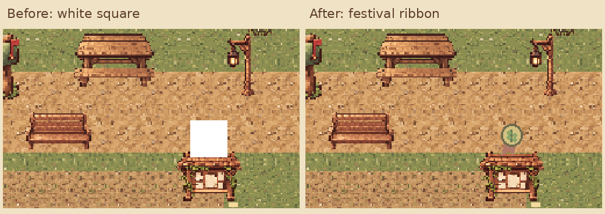

# 长椅旁活动牌白块修复

农场休息长椅右侧的白块是春季播种庆典牌的缎带图标。原 PNG 有正常颜色和透明背景；问题发生在绘制阶段：`_draw()` 中临时加载的 `Texture2D` 在函数返回后失去强引用，而 Canvas 绘制命令只保留底层 RID，实际渲染时就显示为不透明白色矩形。

修复在活动牌节点初始化时加载并持有图标引用，同时明确使用最近邻过滤。四季活动牌使用同一条修复路径。活动日期、奖励、交互、建筑布局和存档 v27 均保持原有规则。Android 更新包的 versionCode 从 25 增至 26，继续使用原包名与签名。

## 实际窗口对比

- [修复前完整窗口](before-farm-bench.png)
- [修复后完整窗口](after-farm-bench.png)

截图来自同一农场默认布局和 Godot 4.3 实际 X11 窗口，使用隔离测试存档。测试用离屏 Viewport 逐像素核对四季图标的首次绘制及时间变化后的重绘；CPU 解码参考 PNG，避免测试本身持有纹理而掩盖引用生命周期问题。32→24 像素缩放的最近邻边界采样存在 GPU 舍入差异，因此只比较采样无歧义的实心内部像素。

## 验证

| 验证 | 结果 |
| --- | --- |
| 修复前实际渲染 | 四季首次绘制与重绘共 8 项像素校验失败，图标显示白块 |
| 修复后实际窗口 | 17 项通过，含 8 项像素校验和 9 张截图落盘 |
| 四季活动业务回归 | 87 项通过 |
| 方案 C 场景物件回归 | 45 项通过 |
| 全农场布局与业务映射 | 107 项通过 |

本次共 256 项专项检查通过，未重跑全工程全部测试。原始记录见 `after-result.json` 和 `regressions.json`。

复现窗口测试：`python3 tools/capture_festival_icons.py`。Windows 与 Android 安装包按现有导出脚本重新构建；未执行 Android 真机或原生 Windows 硬件验收。
